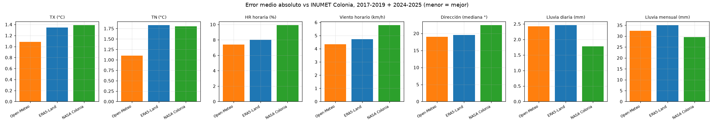

# Conclusión: ¿Open-Meteo, ERA5-Land, NASA o ninguno? — Estación Colonia

Se basa en tres análisis contra INUMET Colonia (lat −34.4518742, lon −57.7677703), tomado como verdad, con los años 2017-2019 y 2024-2025:

- [`analisis_open_meteo_vs_inumet/analisis_comparacion.md`](analisis_open_meteo_vs_inumet/analisis_comparacion.md)
- [`analisis_era5_land_vs_inumet/analisis_era5_land.md`](analisis_era5_land_vs_inumet/analisis_era5_land.md)
- [`analisis_nasa_vs_inumet/analisis_nasa.md`](analisis_nasa_vs_inumet/analisis_nasa.md)

> **Notas sobre los datos:**
> - El archivo `Comparación datos INUMET vs NASA - NASA.csv` corresponde al punto de la **estación San José** (~94 km de Colonia) y solo cubre 2025. Por eso "NASA" se refiere aquí a NASA POWER descargado para las coordenadas de Colonia. El archivo de San José no conviene usarlo para Colonia.
> - ERA5-Land se tomó en el punto −34.40, −57.80, porque el punto más cercano a la estación cae sobre el Río de la Plata y no tiene datos.

## Regla general

**Open-Meteo es la mejor opción para casi todo.** ERA5-Land queda muy cerca en humedad y dirección del viento, y es la mejor para la **distribución de velocidades de viento**. NASA solo gana en **saber qué días llovió**. Para la **cantidad** de lluvia a escala diaria o mensual, los **extremos fríos** y las **rachas horarias**, ninguna alcanza: hay que usar INUMET o una medición propia.

| Error medio vs INUMET (5 años) | Open-Meteo | ERA5-Land | NASA |
|---|---|---|---|
| Temperatura máxima | **1.08 °C** | 1.35 °C | 1.39 °C |
| Temperatura mínima | **1.10 °C** | 1.83 °C | 1.80 °C |
| Humedad horaria | **7.4 %** | 8.0 % | 9.9 % |
| Viento horario | **4.3 km/h** | 4.7 km/h | 5.8 km/h |
| Dirección del viento (mediana) | **19°** | 19.5° | 22° |
| Lluvia diaria | 2.42 mm | 2.46 mm | **1.78 mm** |
| Lluvia mensual | 32.5 mm | 35.0 mm | **29.6 mm** |
| Lluvia, desvío del total de 5 años | **+4 %** | −12 % | −12 % (−43 % en 2025) |

## Qué fuente usar en cada caso

| Dato / uso | Usar | Corrección recomendada | Por qué |
|---|---|---|---|
| **Temperatura máxima diaria** | ✅ **Open-Meteo** | +0.5 °C | MAE 1.08 °C. ERA5-Land 1.35, NASA 1.39 |
| **Temperatura mínima diaria** | ✅ **Open-Meteo** | −0.6 °C | MAE 1.10 °C. ERA5-Land y NASA ~1.8 °C, con sesgo cálido de +1.4 a +1.7 °C |
| Temperatura media mensual / climatología | ✅ **Open-Meteo** | la misma (tabla mensual en el informe) | La corrección validada la deja en MAE 0.87 °C. ERA5-Land corregida, 1.07 °C |
| Días de calor (TX ≥ 30 / 35 °C) | ⚠️ **Open-Meteo** con ajuste por cuantiles | ajuste por cuantiles | Sin ajuste cuenta 27 % menos días ≥ 30 °C (ERA5-Land, 40 % menos) |
| **Heladas / días fríos (TN ≤ 0 / ≤ 3 °C)** | ❌ **Ninguno** | — | Heladas detectadas (de 8 reales): Open-Meteo 6 (solo 3 en el día correcto), ERA5-Land 1, NASA 0 |
| Humedad: promedios y tendencia | ⚠️ **Open-Meteo** (ERA5-Land casi igual) | +5 % (o **+9-10 %** desde 2024) | MAE 7.4 % (OM) vs 8.0 % (ERA5-Land) |
| **Humedad: umbrales altos** (HR > 90 %, mojado foliar) | ❌ **Ninguno** | — | Todas son más secas que la estación, con sesgo creciente (−9 a −14 % en 2025) |
| Humedad y viento nocturnos | ❌ **Sin validar** | — | La estación no observa de 20 a 06 h |
| Viento medio diario (serie) | ⚠️ **Open-Meteo** | ×1.05 a ×1.10 | MAE diario 2.7 km/h, r 0.87 |
| **Estadísticas de viento** (distribución, frecuencia de vientos fuertes, potencial eólico medio) | ✅ **ERA5-Land** | — | Sesgo −0.1 km/h; P99 37.3 vs 38.9 km/h reales (OM 34.2, NASA 43.1) |
| **Dirección del viento / rosa de vientos** | ✅ **Open-Meteo** (ERA5-Land casi igual) | — | Mediana del error 19-19.5°. NASA, 22° |
| **Rachas y viento hora a hora en eventos puntuales** | ❌ **Ninguno** | — | Ninguno reproduce el pico de la tarde; correlación horaria de 0.66 a 0.74 |
| **¿Llovió o no tal día?** (≥ 1 mm) | ✅ **NASA** | sumar de 07 a 07 h | CSI 0.69, vs 0.64 (ERA5-Land) y 0.60 (OM) |
| **Cantidad de lluvia diaria / eventos fuertes (≥ 20 mm)** | ❌ **Ninguno** | — | Eventos ≥ 50 mm acertados (de 19): 4 (ERA5-Land), 5 (OM) y 6 (NASA) |
| **Lluvia mensual** (balance hídrico, riego) | ❌ **Ninguno** (si es obligatorio, Open-Meteo) | — | Error típico de ±30-35 mm/mes en las tres. NASA y ERA5-Land además subestiman en los años recientes |
| Lluvia anual / régimen de largo plazo | ⚠️ **Open-Meteo** | — | +4 % en 5 años (ERA5-Land y NASA, −12 %) |

✅ apto · ⚠️ apto con corrección o con cautela · ❌ no usar

## Cuándo conviene no usar ninguna fuente

1. **Cantidad de lluvia diaria o mensual, y eventos de lluvia intensa.** Es el punto débil de los tres productos. Para riego, balance hídrico, drenaje o seguros climáticos, hace falta INUMET o un pluviómetro propio.
2. **Heladas y temperaturas bajas extremas.** Todos suavizan las noches frías. ERA5-Land y NASA prácticamente no registran heladas en Colonia.
3. **Humedad alta (> 85-90 %) y horas de mojado.** El sesgo seco hace que se pierdan justo los eventos que importan para los modelos de enfermedades.
4. **Rachas y viento hora a hora.** Ninguna fuente sigue bien el ciclo de la tarde. Para pulverizaciones o decisiones operativas hace falta medición local.
5. **Variables nocturnas de humedad y viento.** No se pudieron validar.

## Recomendaciones de uso

- **Una sola fuente para todo:** Open-Meteo, con las correcciones de la tabla. Para la lluvia, siempre que se pueda, INUMET.
- **Si el foco es el recurso eólico** (distribución de velocidades, no serie horaria): ERA5-Land.
- **Si se usa NASA para lluvia:** solo como indicador de ocurrencia ("hubo lluvia sí/no"), sumando de 07 a 07 h.
- **No mezclar sin alinear:** INUMET rotula la lluvia de 07 h del día D a 07 h del día D+1 con la fecha D. Si se suma por día calendario, todas las fuentes empeoran mucho (por ejemplo, la correlación de Open-Meteo baja de 0.70 a 0.56).
- **Validez:** los resultados son para Colonia (zona costera). En otro punto del país el desempeño puede cambiar; los scripts incluidos permiten repetir la validación.

## Chacras sin estación INUMET al lado

La validación se extendió a las 21 estaciones y 72 pluviómetros del país, con el criterio de distancia para las chacras de maíz, en [`analisis_distancia_estaciones/CRITERIO_distancia_estaciones.md`](analisis_distancia_estaciones/CRITERIO_distancia_estaciones.md):

- **Temperatura y humedad:** usar 50 % la estación INUMET más cercana + 50 % Open-Meteo en la chacra, hasta ~120 km. Para la temperatura máxima, Open-Meteo se corrige antes por cuantiles.
- **Lluvia:** usar el promedio IDW de los 3 pluviómetros más cercanos, hasta ~60 km.
