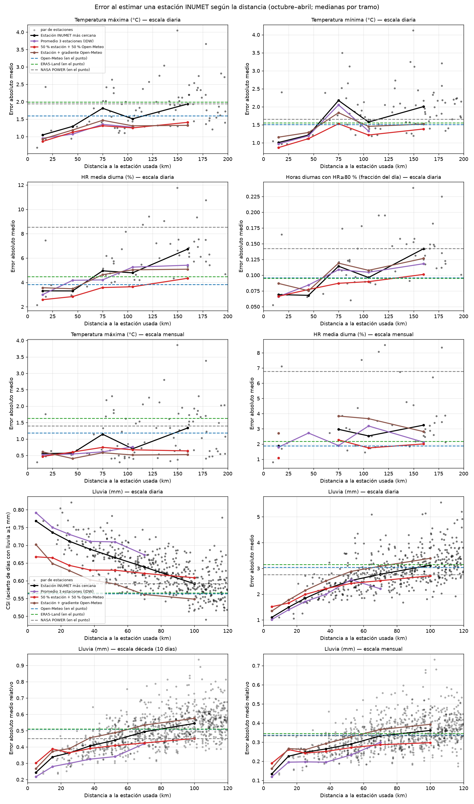
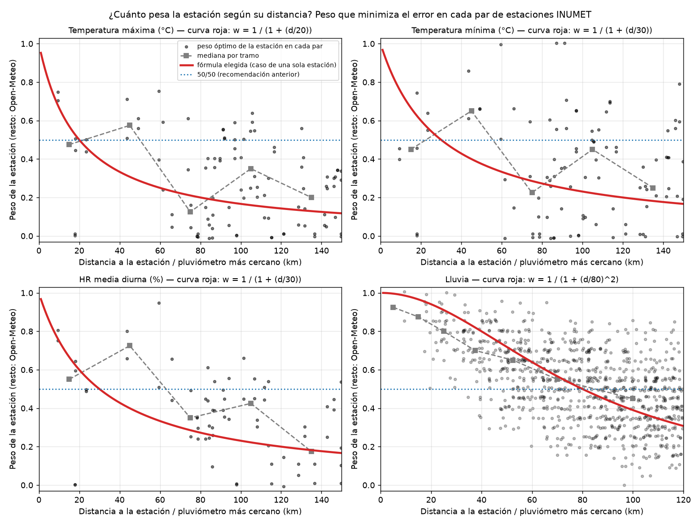
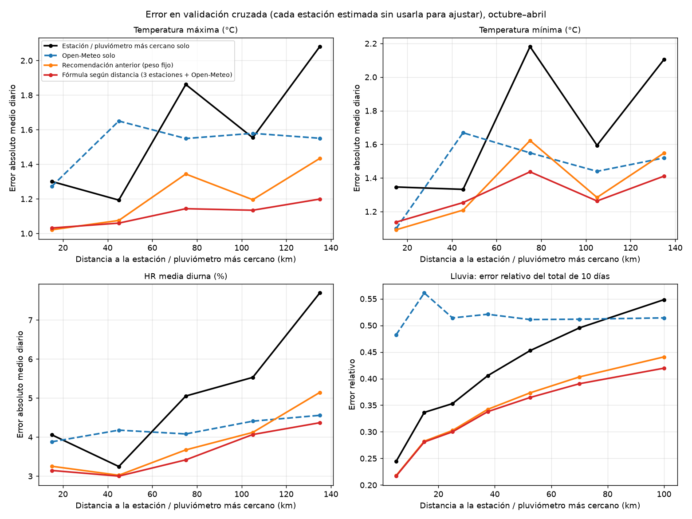
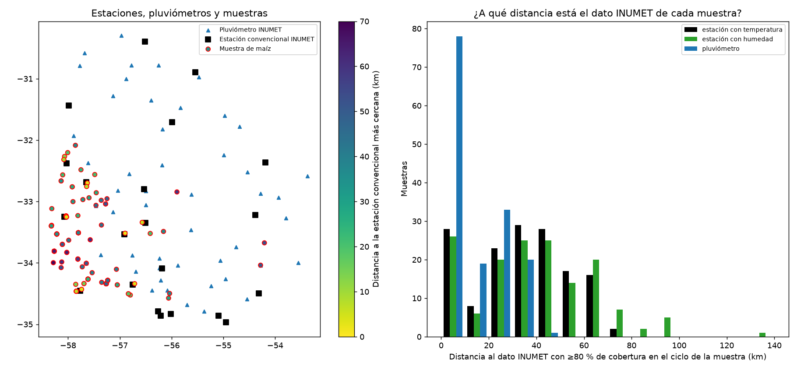

# ¿Cuándo usar INUMET, cuándo una grilla y cuándo una mezcla? Criterio para las chacras de maíz

## Respuesta corta: qué haría

**Una sola fórmula para todas las variables, en la que el peso de cada fuente depende de la distancia:**

\[
\text{valor en la chacra} = \frac{\dfrac{x_1}{d_1^{\,p}} + \dfrac{x_2}{d_2^{\,p}} + \dfrac{x_3}{d_3^{\,p}} + \dfrac{G}{L^{p}}}{\dfrac{1}{d_1^{\,p}} + \dfrac{1}{d_2^{\,p}} + \dfrac{1}{d_3^{\,p}} + \dfrac{1}{L^{p}}}
\]

- \(x_1, x_2, x_3\): las 3 estaciones INUMET (o pluviómetros) más cercanas **que tienen dato ese día**; \(d_i\) es su distancia a la chacra en km.
- \(G\): Open-Meteo en la chacra.
- \(L\): la grilla entra como si fuera **una estación más, ubicada a \(L\) km**. Es "lo que vale" Open-Meteo medido en distancia.

| Variable | Grilla \(G\) | \(p\) | \(L\) | Peso de Open-Meteo en tus chacras (mediana) | Error típico en tus chacras* |
|---|---|---:|---:|---:|---|
| **Temperatura máxima** | Open-Meteo **corregido por cuantiles** contra la estación más cercana | 1 | **20 km** | 49 % | ±1.05 °C diario, ±0.5 °C mensual |
| **Temperatura mínima** | Open-Meteo | 1 | **30 km** | 39 % | ±1.2 °C diario, ±0.8 °C mensual |
| **Humedad relativa (diurna)** | Open-Meteo | 1 | **30 km** | 41 % | ±3.1 % diario, ±2.1 % mensual |
| Fracción de horas con HR ≥ 80 % | Open-Meteo | 1 | 50 km | — | ±0.08 diario |
| **Lluvia** | Open-Meteo | **2** | **80 km** | 1 % | ±12–19 % del total mensual; acierta el 76–79 % de los días con lluvia |

\* Error medio en validación cruzada con estaciones INUMET a 0–60 km de la estación más cercana (temperatura y humedad) o a 0–20 km del pluviómetro más cercano (lluvia), que es el rango de tus chacras.

**Qué cambia respecto de la versión anterior (50 % estación + 50 % Open-Meteo):**

- **El peso ya no es fijo.** Una chacra con la estación a 10 km toma ~55–60 % de esa estación, y una con la estación a 80 km toma ~55–65 % de Open-Meteo. No hay umbrales de distancia: la fórmula pasa sola de "casi todo estación" a "casi todo grilla".
- **Entran la 2.ª y 3.ª estación más cercanas.** Esto aporta tanto como el peso por distancia.
- **Es mejor, con diferencia significativa, en temperatura máxima** (−0.09 °C diario, gana en el 77 % de los casos) **y en humedad** (−0.25 % diario). **En temperatura mínima empata** con el 50/50. **En lluvia** es igual al promedio de pluviómetros cerca y mejor lejos.
- En tus chacras el cambio es moderado, porque están relativamente cerca de las estaciones: en la mediana, Open-Meteo pesa ~40–50 % en temperatura y humedad (antes era 50 %) y ~1 % en lluvia (antes 0 %).

Las series diarias ya armadas con esta fórmula para cada ubicación de muestreo están en `series_diarias_muestras.csv`, y la recomendación por muestra (con el peso de Open-Meteo en cada una) en `recomendacion_por_muestra.csv`. Al final está la [conclusión con la fórmula para cada caso](#8-conclusión-qué-fórmula-usar-en-cada-caso).

---

## 1. Cómo se armó el criterio

La pregunta "¿a partir de qué distancia una estación deja de servir?" no se puede contestar en las chacras, porque ahí no hay medición. Sí se puede contestar **en las propias estaciones INUMET**:

1. Se toma una estación INUMET B como si fuera la chacra (su dato es la "verdad").
2. Se la estima con:
   - **otra estación A** ubicada a *d* km (todas las combinaciones de estaciones, hasta 200 km para temperatura y humedad y hasta 120 km para lluvia);
   - **las grillas en el punto B**: Open-Meteo, ERA5-Land (Copernicus) y NASA POWER, más el promedio de las tres;
   - **estrategias híbridas**: mezclas estación + grilla con pesos 25/50/75 %, grilla corregida con la estación (sesgo mensual, mapeo de cuantiles, método delta) y promedio de las 3 estaciones más cercanas (IDW);
   - **pesos que dependen de la distancia** (sección 4).
3. Se mide el error y se grafica contra la distancia.

Datos usados:

- **Estaciones:** 21 convencionales (TX, TN y HR horaria de 07 a 19 h) y 72 pluviómetros.
- **Período:** 2017–2019 y 2024–2025, **solo de octubre a abril** (ciclo del maíz).
- **Grillas:** bajadas en las 79 ubicaciones de estaciones y pluviómetros. La lluvia ERA5-Land se bajó del CDS de Copernicus, porque la de Open-Meteo para ERA5-Land viene vacía.
- **Alineación:** lluvia de 07 a 07 h con la fecha del día de inicio, como la publica INUMET (verificado en los 72 pluviómetros). TX y TN por día calendario.

Ejemplo de cómo se lee: "estación a 30–60 km, error 1.29 °C" significa que si usás para tu chacra una estación ubicada a esa distancia, el error medio diario esperado de la máxima es ~1.3 °C.



*Cada punto gris es un par de estaciones. Las líneas llenas son medianas por tramo de distancia; las líneas punteadas, el error de cada grilla en el mismo punto.*

---

## 2. Temperatura y humedad: mezclar estación y grilla gana siempre

### Error medio diario según la distancia a la estación usada (octubre–abril, mediana de los pares)

| Método | 0–30 km | 30–60 km | 60–90 km | 90–120 km |
|---|---:|---:|---:|---:|
| **Temperatura máxima (°C)** | | | | |
| Estación INUMET sola | 1.05 | 1.29 | 1.81 | 1.51 |
| 50 % estación + 50 % Open-Meteo | 0.86 | 1.13 | 1.31 | 1.25 |
| 50 % estación + 50 % Open-Meteo corregido por cuantiles | 0.73 | 1.12 | 1.38 | 1.16 |
| Open-Meteo solo / ERA5-Land / NASA | 1.60 / 1.99 / 1.94 | | | |
| **Temperatura mínima (°C)** | | | | |
| Estación INUMET sola | 1.01 | 1.22 | 2.17 | 1.58 |
| 50 % estación + 50 % Open-Meteo | 0.87 | 1.12 | 1.53 | 1.22 |
| Open-Meteo solo / ERA5-Land / NASA | 1.51 / 1.55 / 1.65 | | | |
| **HR media diurna (%)** | | | | |
| Estación INUMET sola | 3.31 | 3.30 | 4.96 | 4.79 |
| 50 % estación + 50 % Open-Meteo | 2.58 | 2.84 | 3.58 | 3.64 |
| Open-Meteo solo / ERA5-Land / NASA | 3.83 / 4.48 / 8.53 | | | |

Pares de estaciones por tramo: 8 / 6 / 26 / 32 para temperatura y 8 / 4 / 20 / 20 para HR. Cada par cuenta en las dos direcciones.

Qué dicen los datos:

- **Estación sola contra grilla sola.** La estación vecina le gana a Open-Meteo hasta **~60 km** en mínima y en humedad, y hasta **~85 km** en máxima. Más lejos, la grilla es mejor. Ese sería el umbral si hubiera que elegir **una** fuente.
- **Pero no hace falta elegir.** El promedio 50/50 estación + Open-Meteo tiene menos error que cualquiera de las dos por separado en **todos** los tramos de 0 a 120 km.
- **Robustez par por par** (pares a ≤120 km):

  | Variable | Mezcla le gana a la estación sola | Mezcla le gana a Open-Meteo solo |
  |---|---:|---:|
  | Máxima | 82 % | 74 % |
  | Mínima | 94 % | 64 % |
  | HR | 92 % | 81 % |

- **Por qué funciona.** Los errores de las dos fuentes son de naturaleza distinta y en buena medida independientes, así que al promediar se cancelan parcialmente:
  - la estación está bien calibrada, pero mide el clima de *otro lugar*;
  - la grilla está en el lugar correcto, pero tiene sesgos sistemáticos (es más fría en las máximas y más seca) y suaviza.
- **Pesos fijos.** Se probaron 25/50/75 %, y 50/50 fue el mejor o empató en casi todos los tramos. **Pero un peso fijo no es lo óptimo:** la sección 4 muestra que un peso que baja con la distancia, sumando la 2.ª y 3.ª estación, es mejor.
- **Qué grilla mezclar.** Open-Meteo. Mezclar con el promedio de las tres grillas empeora la humedad (por NASA) y no mejora la temperatura.
- **Otros híbridos probados, peores a escala diaria:**
  - el "método delta" (estación + diferencia de grilla entre los dos puntos);
  - la grilla corregida solo por el sesgo mensual de la estación;
  - el promedio IDW de 3 estaciones **sin grilla**. Con la grilla incluida como una estación más, en cambio, es lo mejor (sección 4).

### El detalle que importa para Fusarium: días sobre umbral

Al promediar se suavizan los extremos. Para la temperatura máxima esto importa, porque Open-Meteo subestima los días calurosos y la mezcla hereda parte de ese sesgo. Por eso, **para la máxima, Open-Meteo se corrige por cuantiles antes de mezclar**: se compara, mes a mes, la distribución de Open-Meteo en el punto de la estación con la de la estación, y esa corrección se aplica a Open-Meteo en la chacra. Así se elimina casi todo el faltante de días calurosos (los números con la fórmula final están en la sección 4).

Para la mínima y la humedad, la corrección por cuantiles no mejora el error diario y empeora el error en los conteos, así que se usa Open-Meteo sin corregir.

---

## 3. Lluvia: varios pluviómetros, la grilla casi no pesa

| Método | 0–10 km | 10–20 km | 20–30 km | 30–45 km | 45–60 km | 60–80 km |
|---|---:|---:|---:|---:|---:|---:|
| **Error relativo del total mensual** | | | | | | |
| Pluviómetro más cercano | 13 % | 23 % | 25 % | 26 % | 29 % | 33 % |
| Promedio IDW de 3 pluviómetros | 12 % | 20 % | 20 % | 20 % | 23 % | 30 % |
| Promedio de las 3 grillas | 29 % | | | | | |
| **Error relativo del total de 10 días** | | | | | | |
| Pluviómetro más cercano | 24 % | 34 % | 36 % | 41 % | 44 % | 49 % |
| Promedio IDW de 3 pluviómetros | 22 % | 28 % | 30 % | 33 % | 34 % | 42 % |
| Mejor grilla (promedio de las 3) | 43 % | | | | | |
| **Acierto de días con lluvia ≥ 1 mm (CSI)** | | | | | | |
| Pluviómetro más cercano | 0.77 | 0.74 | 0.71 | 0.69 | 0.67 | 0.64 |
| Promedio IDW de 3 pluviómetros | 0.79 | 0.75 | 0.73 | 0.71 | 0.71 | 0.67 |
| Mejor grilla (NASA) | 0.59 | | | | | |

Pares de pluviómetros por tramo: 2 / 8 / 30 / 74 / 138 / 192 (mediana de los pares). La distancia es la del pluviómetro más cercano.

- **Un solo pluviómetro.** Le gana a la mejor grilla hasta **~55–60 km** en montos mensuales y de 10 días, y hasta **~90 km** en ocurrencia de lluvia.
- **Promediar los 3 más cercanos (1/d²)** le gana al pluviómetro solo en el 91–95 % de los pares en montos, y a las grillas en el 94–100 %.
- **Sumar la grilla** solo aporta cuando los pluviómetros están lejos (sección 4). Con la fórmula final, a menos de ~30 km la grilla pesa menos del 10 % y el resultado es prácticamente el promedio de pluviómetros.
- **Correcciones de grilla con el pluviómetro.** Tanto el sesgo mensual como el método delta son peores: la lluvia de las grillas falla en el *día* y en el *lugar*, no en un sesgo fijo.
- **Montos diarios.** Siguen siendo imprecisos incluso con pluviómetros (±1–2 mm por día a menos de 30 km). La lluvia conviene usarla agregada (10 días, mes, período de floración) o como ocurrencia (días con lluvia).

---

## 4. Peso según la distancia: de "50/50" a una fórmula

La idea es que no es lo mismo una chacra con la estación a 10 km que una con la estación a 100 km. Para probarlo se usó la misma validación de la sección 1, pero en vez de pares fijos se armaron **configuraciones**: para cada estación B se hace de cuenta que las *r* estaciones más cercanas no existen, de modo que la más cercana disponible queda a \(d_1\), la segunda a \(d_2\) y la tercera a \(d_3\). Así hay casos con la estación más cercana entre 9 y 150 km (100 configuraciones para temperatura, 68 para humedad y 932 para lluvia).

### 4.1 ¿El peso óptimo baja con la distancia? Sí

Para cada configuración se buscó el peso fijo \(w\) de la estación más cercana (el resto, Open-Meteo) que minimiza el error en esa estación:

| Variable | Correlación peso óptimo vs distancia (Spearman) | Mediana del peso óptimo por tramo |
|---|---|---|
| Temperatura máxima | −0.24 (p = 0.02) | 0–30 km: 0.48 · 30–60: 0.57 · 60–90: 0.12 · 90–120: 0.35 · 120–150: 0.20 |
| Temperatura mínima | −0.12 (p = 0.25, no significativa) | 0.45 · 0.65 · 0.22 · 0.45 · 0.25 |
| HR diurna | −0.43 (p < 0.001) | 0.55 · 0.73 · 0.35 · 0.43 · 0.18 |
| Lluvia (montos de 10 días) | −0.51 (p < 0.001) | 0–10 km: 0.92 · 10–20: 0.88 · 20–30: 0.80 · 30–45: 0.70 · 45–60: 0.65 · 60–80: 0.55 · 80–120: 0.45 |



*Cada punto es una configuración. La curva roja es el peso que le da la fórmula final a la estación cuando hay una sola. La dispersión es grande, porque cada par de estaciones tiene sus particularidades (costa/interior, calidad del sensor), así que los parámetros no se ajustaron a los puntos sino minimizando directamente el error.*

La tendencia es clara en lluvia y humedad, moderada en temperatura máxima y débil en mínima. A menos de 60 km el peso óptimo de la estación ronda 0.5–0.7, no 1: aun cerca, una estación mide otro microclima.

### 4.2 Qué fórmulas se probaron

| Familia | Fórmula | Parámetros |
|---|---|---|
| Peso fijo | \(w\,x_1 + (1-w)\,G\) | \(w\) |
| Exponencial | \(w = e^{-d_1/L}\) | \(L\) |
| 1 estación + grilla | \(w = 1/(1 + (d_1/L)^p)\) | \(p, L\) |
| 2 o 3 estaciones + grilla | la de arriba, con la grilla como estación a \(L\) km | \(p, L\) |
| Con "pepita" | \(1/d_i^p\) reemplazado por \(1/(d_0^p + d_i^p)\) | \(p, L, d_0\) |
| IDW sin grilla | \(L = \infty\) | \(p\) |

Cada una con Open-Meteo, Open-Meteo corregido por cuantiles (temperatura y humedad) y, para lluvia, Open-Meteo, Open-Meteo + NASA y el promedio de las 3 grillas.

**Cómo se evitó el sobreajuste:** los parámetros se eligieron **sin la estación evaluada** (validación cruzada dejando una estación afuera: 21 pliegues para temperatura, 14 para humedad y 72 para lluvia), minimizando el error medio con el mismo peso para cada tramo de distancia. Las diferencias con la recomendación anterior se testearon con un **bootstrap remuestreando estaciones** (2000 réplicas).

### 4.3 Resultados (error en validación cruzada, media por tramo de distancia a la estación más cercana)

| Método | 0–30 km | 30–60 km | 60–90 km | 90–120 km | 120–150 km | Promedio |
|---|---:|---:|---:|---:|---:|---:|
| **Temperatura máxima, error diario (°C)** | | | | | | |
| Estación más cercana sola | 1.30 | 1.19 | 1.86 | 1.55 | 2.08 | 1.60 |
| Open-Meteo solo | 1.27 | 1.65 | 1.55 | 1.58 | 1.55 | 1.52 |
| Anterior: 50 % estación + 50 % Open-Meteo corregido | **1.02** | 1.08 | 1.34 | 1.20 | 1.43 | 1.21 |
| **Fórmula (3 estaciones + Open-Meteo corregido, L = 20 km)** | 1.03 | **1.06** | **1.14** | **1.13** | **1.20** | **1.11** |
| **Temperatura mínima, error diario (°C)** | | | | | | |
| Estación más cercana sola | 1.35 | 1.33 | 2.18 | 1.59 | 2.10 | 1.71 |
| Open-Meteo solo | 1.10 | 1.67 | 1.55 | 1.44 | 1.52 | 1.46 |
| Anterior: 50 % estación + 50 % Open-Meteo | **1.09** | **1.21** | 1.62 | 1.28 | 1.55 | 1.35 |
| **Fórmula (3 estaciones + Open-Meteo, L = 30 km)** | 1.14 | 1.25 | **1.44** | **1.26** | **1.41** | **1.30** |
| **HR diurna, error diario (%)** | | | | | | |
| Estación más cercana sola | 4.06 | 3.25 | 5.05 | 5.53 | 7.69 | 5.12 |
| Open-Meteo solo | 3.88 | 4.18 | 4.08 | 4.41 | 4.56 | 4.22 |
| Anterior: 50 % estación + 50 % Open-Meteo | 3.25 | 3.02 | 3.67 | 4.12 | 5.14 | 3.84 |
| **Fórmula (3 estaciones + Open-Meteo, L = 30 km)** | **3.15** | **3.00** | **3.42** | **4.07** | **4.37** | **3.60** |

| Método | 0–10 km | 10–20 km | 20–30 km | 30–45 km | 45–60 km | 60–80 km | 80–120 km | Promedio |
|---|---:|---:|---:|---:|---:|---:|---:|---:|
| **Lluvia, error relativo del total de 10 días** | | | | | | | | |
| Pluviómetro más cercano solo | 24 % | 34 % | 35 % | 41 % | 45 % | 50 % | 55 % | 41 % |
| Open-Meteo solo | 48 % | 56 % | 51 % | 52 % | 51 % | 51 % | 51 % | 52 % |
| Anterior: IDW 3 pluviómetros (1/d²) | 22 % | 28 % | 30 % | 34 % | 37 % | 40 % | 44 % | 34 % |
| **Fórmula (3 pluviómetros 1/d² + Open-Meteo, L = 80 km)** | 22 % | 28 % | 30 % | 34 % | **36 %** | **39 %** | **42 %** | **33 %** |
| **Lluvia, acierto de días con lluvia (CSI)** | | | | | | | | |
| Anterior: IDW 3 pluviómetros | 0.79 | 0.76 | 0.73 | 0.70 | 0.68 | 0.66 | 0.63 | 0.71 |
| Fórmula | 0.79 | 0.76 | 0.73 | 0.70 | 0.68 | 0.65 | 0.62 | 0.70 |



**¿La mejora es real? Bootstrap contra la recomendación anterior** (diferencia fórmula − anterior; negativo = la fórmula tiene menos error):

| Variable | Error diario: diferencia [IC 95 %] | Gana en | Error mensual: diferencia [IC 95 %] |
|---|---|---:|---|
| Temperatura máxima | **−0.09 °C [−0.13, −0.06]** | 77 % | **−0.08 °C [−0.13, −0.03]** |
| Temperatura mínima | −0.05 °C [−0.10, +0.01] (no significativa) | 69 % | −0.01 °C [−0.09, +0.08] |
| HR diurna | **−0.25 % [−0.37, −0.10]** | 64 % | −0.15 % [−0.38, +0.07] |
| Lluvia (10 días / mensual) | **−0.7 / −0.6 puntos de error relativo** (IC excluye 0) | 72 % | CSI: −0.006 (algo peor) |

**Días sobre umbral por campaña** (mediana del sesgo / error absoluto, en días; estación más cercana a 0–60 km):

| Método | TX ≥ 30 °C | TX ≥ 32 °C | HR diurna ≥ 80 % | TN ≤ 5 °C |
|---|---:|---:|---:|---:|
| Estación sola | 0 / 9.7 | 0 / 5.7 | 0 / 7.7 | 0 / 0.7 |
| Anterior (50/50; corregido por cuantiles en TX) | −1.7 / 4.8 | −1.8 / 3.3 | −4.3 / 6.0 | −0.8 / 1.0 |
| **Fórmula** | **−0.7 / 4.3** | **−0.7 / 3.0** | **−3.2 / 4.8** | −0.7 / 0.8 |

En promedio hay 50 días por campaña con TX ≥ 30 °C, 28 con TX ≥ 32 °C, 34 con HR ≥ 80 % y 2.3 con TN ≤ 5 °C.

### 4.4 Qué se aprende

1. **Sumar la 2.ª y 3.ª estación importa tanto como el peso por distancia.** Con una sola estación + grilla con peso por distancia, la mejora sobre 50/50 es chica (máxima 1.16 contra 1.21 °C; HR 3.76 contra 3.84 %). Con tres estaciones baja a 1.11 °C y 3.60 %. Las estaciones vecinas aportan información independiente y la grilla rellena lo que no ven.
2. **Exponente: \(p = 1\) para temperatura y humedad, \(p = 2\) para lluvia.** Dejar \(p\) libre no mejoró la validación cruzada. Que la lluvia necesite \(p = 2\) (cae más rápido con la distancia) es coherente con que es mucho más local que la temperatura.
3. **La "pepita" \(d_0\) no hace falta.** Con pepita libre, el error en validación cruzada es igual o algo peor que con \(p = 1\) sin pepita (máxima 1.13 contra 1.11 °C; HR 3.63 contra 3.60 %).
4. **\(L\) es estable.** Entre los pliegues de la validación cruzada, \(L\) quedó en 20–30 km para la máxima, 30–50 km para la mínima, 20–40 km para la HR, 30–70 km para la fracción de HR ≥ 80 % y 80 km en los 72 pliegues de lluvia.
5. **Cómo leer \(L\).** "Open-Meteo corregido por cuantiles vale como una estación a 20 km" para la máxima: la corrección le saca el sesgo frío y queda muy competitiva. Para la mínima y la humedad Open-Meteo vale como una estación a 30 km, y para la lluvia como un pluviómetro a 80 km.
6. **Lluvia: alcanza con Open-Meteo.** Usar como grilla el promedio Open-Meteo + NASA o el de las 3 grillas baja el error de 10 días 1 punto más (33 % → 32 %), solo con pluviómetros a más de 45 km, y acierta algo menos los días de lluvia. Como tus chacras tienen pluviómetro a ≤41 km, se usa Open-Meteo (sin bajar ERA5-Land de Copernicus en cada chacra).
7. **Mínima: la fórmula no gana con claridad.** Es mejor lejos (>60 km) y apenas peor cerca (0.04–0.05 °C, con 7 pares a <60 km, dentro del ruido). Se usa igual, por coherencia con las demás variables.

### 4.5 Cómo se reparte el peso en casos típicos

| Distancias a las 3 estaciones más cercanas | Variable | Estación 1 | Estación 2 | Estación 3 | Open-Meteo |
|---|---|---:|---:|---:|---:|
| 10 / 50 / 90 km | Temperatura máxima | 55 % | 11 % | 6 % | 28 % |
| | Mínima y HR | 61 % | 12 % | 7 % | 20 % |
| 35 / 60 / 90 km | Temperatura máxima | 27 % | 16 % | 10 % | 47 % |
| | Mínima y HR | 32 % | 19 % | 12 % | 37 % |
| 80 / 110 / 140 km | Temperatura máxima | 16 % | 12 % | 9 % | 64 % |
| | Mínima y HR | 20 % | 15 % | 12 % | 54 % |
| Pluviómetros a 5 / 15 / 25 km | Lluvia | 87 % | 10 % | 3 % | 0 % |
| Pluviómetros a 30 / 45 / 60 km | Lluvia | 54 % | 24 % | 14 % | 8 % |
| Pluviómetros a 80 / 100 / 120 km | Lluvia | 32 % | 21 % | 14 % | 32 % |

Con una sola estación disponible, su peso es \(w = 1/(1 + (d/L)^p)\):

| Variable | 5 km | 10 km | 25 km | 50 km | 75 km | 100 km | 150 km |
|---|---:|---:|---:|---:|---:|---:|---:|
| Temperatura máxima (L = 20) | 0.80 | 0.67 | 0.44 | 0.29 | 0.21 | 0.17 | 0.12 |
| Mínima y HR (L = 30) | 0.86 | 0.75 | 0.55 | 0.37 | 0.29 | 0.23 | 0.17 |
| Lluvia (L = 80, p = 2) | 1.00 | 0.98 | 0.91 | 0.72 | 0.53 | 0.39 | 0.22 |

Todas las tablas completas (todas las familias, error mensual, parámetros y bootstrap contra cada alternativa) están en `tablas_peso_distancia.md`.

---

## 5. Tus muestras



| Distancia de la muestra al dato INUMET con ≥80 % de cobertura en su ciclo (octubre del año previo → muestreo) | Mediana | P75 | Máximo |
|---|---:|---:|---:|
| Estación con temperatura | 34 km | 47 km | 73 km |
| Estación con humedad | 38 km | 57 km | 131 km |
| Pluviómetro | 8 km | 25 km | 41 km |

Peso de Open-Meteo que resulta de la fórmula en tus 151 muestras:

| Variable | Mediana | Rango |
|---|---:|---:|
| Temperatura máxima | 49 % | 11–60 % |
| Temperatura mínima | 39 % | 8–50 % |
| HR diurna | 41 % | 8–72 % |
| Lluvia | 1 % | 0–10 % |

- Las estaciones más usadas son Mercedes, Colonia, San José y Paysandú.
- **Ojo con la humedad.** Young, Paysandú, Paso de los Toros, Tacuarembó y Treinta y Tres casi no tienen HR en los datos. Por eso la humedad de muchas chacras del litoral norte viene de Mercedes o Salto, más lejos que la estación de temperatura. El CSV diario indica, día por día, qué estaciones se usaron y a cuántos km.
- **JA001 (Ruta 3 y 26, Queguay)** tiene la estación con HR más cercana a 131 km. Antes ahí se usaba Open-Meteo solo; ahora la fórmula le da 72 % a Open-Meteo y 28 % a las estaciones, sin necesidad de un corte manual.
- Solo se usan estaciones a ≤200 km y pluviómetros a ≤120 km, que es el rango validado. Si un día no hay ninguna con dato, queda Open-Meteo solo.

### Archivos entregados

- `series_diarias_muestras.csv`: una fila por día y ubicación de muestreo (2017–2019 y 2024–2025). Columnas:
  - `tx`, `tn`, `hr`, `hr80` (fracción de horas diurnas con HR ≥ 80 %) y `pp`, ya con la fórmula;
  - `peso_openmeteo_tx`, `_tn`, `_hr`, `_hr80`, `_pp`: qué fracción del valor aportó Open-Meteo ese día;
  - `estaciones_t_usadas` / `d_estaciones_t_km`, `estaciones_hr_usadas` / `d_estaciones_hr_km`, `pluviometros_usados` / `d_pluviometros_km`: las 3 estaciones o pluviómetros usados ese día y sus distancias;
  - los componentes por separado, para análisis de sensibilidad: `*_estacion` (estación más cercana sola), `*_openmeteo`, `tx_openmeteo_corregido` y `pp_pluviometros` (IDW de pluviómetros sin grilla, el método anterior);
  - `hr_24h_openmeteo_no_validada`, la HR de 24 h de Open-Meteo, incluida porque la HR nocturna importa para Fusarium. **No está validada**: INUMET no da HR nocturna.
- `recomendacion_por_muestra.csv`: por muestra, las 3 estaciones y los 3 pluviómetros más cercanos con dato en su ciclo, sus distancias, el peso de Open-Meteo por variable y la fórmula usada.
- `tablas.md`: tablas de la comparación por pares (secciones 2 y 3).
- `tablas_peso_distancia.md`: tablas completas de la sección 4.

---

## 6. Limitaciones (para la sección de métodos de la tesis)

1. **Pocos pares de estaciones convencionales cercanas.** Hay 7 pares a menos de 60 km, la mayoría en Montevideo y la costa este. Los parámetros de la fórmula para temperatura y humedad están determinados sobre todo por los casos a 60–150 km. Que la forma \(1/d\) dé \(w \to 1\) al acercarse a la estación es una hipótesis razonable, pero a menos de 9 km no se pudo verificar: no hay pares tan cercanos.
2. **La mejora de la fórmula es moderada.** Es significativa en temperatura máxima y humedad, pero del orden de 0.1 °C y 0.25 % diarios. En temperatura mínima no se distingue del 50/50. La conclusión robusta es que conviene **combinar** fuentes. El peso por distancia es un ajuste fino que se justifica sobre todo cuando las distancias de las chacras son muy distintas entre sí.
3. **La "verdad" también tiene errores.** Por ejemplo, la HR de Colonia sube de forma anómala en 2024–2025, como se vio en el análisis anterior. Parte del error estación–estación es error de medición. Promediar varias estaciones, además, amortigua fallas puntuales de una de ellas.
4. **Solo HR diurna (07–19 h).** La humedad y el mojado nocturno, clave para la infección por Fusarium, no se pueden validar con estos datos. La HR de 24 h de Open-Meteo se entrega como referencia, sin garantía.
5. **Uruguay es plano.** No se corrigió por altura. En otro relieve, la temperatura entre estaciones se separaría más rápido con la distancia y \(L\) cambiaría.
6. **Conteos de HR alta.** La fórmula subestima en ~3–4 días por campaña los días con HR media diurna ≥ 80 % (de ~34). Si un índice tuyo depende críticamente de ese umbral, conviene compararlo con `hr_estacion`.

## 7. Reproducir

```bash
cd analisis_distancia_estaciones
/tmp/inumet_venv/bin/python descargas.py        # Open-Meteo, NASA POWER y lluvia ERA5-Land (CDS) en estaciones y pluviómetros
/tmp/inumet_venv/bin/python analisis.py         # validación cruzada estación vs estación vs grillas vs híbridos (secciones 2-3)
/tmp/inumet_venv/bin/python peso_distancia.py   # pesos según distancia, validación cruzada, bootstrap, conteos (sección 4)
/tmp/inumet_venv/bin/python informe.py          # figuras, tablas.md y recomendacion_por_muestra.csv
/tmp/inumet_venv/bin/python series_muestras.py  # series diarias con la fórmula en cada ubicación de muestreo
```

- `datos.py` lee el KMZ, el Excel de INUMET y los pluviómetros.
- La fórmula está en una sola función, `combinar()` de `peso_distancia.py`, que usan tanto la validación como las series. Los parámetros por variable están en `FORMULA`.
- Las descargas quedan en `cache/grillas/`. `series_muestras.py` baja además la temperatura, la HR y la lluvia de Open-Meteo en cada chacra.
- La lluvia ERA5-Land requiere `~/.cdsapirc` con un token de Copernicus. El CDS solo acepta pedidos de a uno.

---

## 8. Conclusión: qué fórmula usar en cada caso

**Fórmula general** (la misma para todo; solo cambian \(p\), \(L\) y la grilla):

\[
\text{valor} = \frac{\sum_{i=1}^{3} x_i / d_i^{\,p} \;+\; G / L^{p}}{\sum_{i=1}^{3} 1 / d_i^{\,p} \;+\; 1 / L^{p}}
\]

con \(x_i\) las 3 estaciones (o pluviómetros) INUMET más cercanas con dato ese día, \(d_i\) su distancia en km (mínimo 1 km) y \(G\) Open-Meteo en la chacra.

| Caso | \(G\) | \(p\) | \(L\) | Resultado validado |
|---|---|---:|---:|---|
| **Temperatura máxima** | Open-Meteo corregido por cuantiles (mes a mes, contra la estación más cercana) | 1 | 20 km | Mejor que 50/50 corregido: −0.09 °C diario y −0.08 °C mensual (significativo). Conteo de días ≥ 30 °C con sesgo de −0.7 días. |
| **Temperatura mínima** | Open-Meteo | 1 | 30 km | Empata con 50/50 (−0.05 °C, no significativo). Mejor que la estación sola (−0.40 °C) y que Open-Meteo solo (−0.16 °C). |
| **HR media diurna** | Open-Meteo | 1 | 30 km | Mejor que 50/50: −0.25 % diario (significativo). Error de días con HR ≥ 80 %: 4.8 contra 6.0 días. |
| **Fracción de horas con HR ≥ 80 %** | Open-Meteo | 1 | 50 km | Prácticamente igual a 50/50 (−0.003). |
| **Lluvia (montos y ocurrencia)** | Open-Meteo | 2 | 80 km | Igual al promedio de 3 pluviómetros a <30 km y mejor lejos (10 días: 42 % contra 44 % a 80–120 km). |

**Según la distancia de la chacra a las estaciones** (lo resuelve la fórmula sola, sin umbrales):

| Situación | Qué hace la fórmula | Ejemplo |
|---|---|---|
| Estación a <10 km | Dominan las estaciones (~70–80 % en temperatura y humedad, >95 % en lluvia) | Estaciones a 10 / 50 / 90 km → máxima: 72 % estaciones, 28 % Open-Meteo |
| Estación a 25–50 km (la mayoría de tus chacras) | Reparto parejo: ~50 % estaciones, ~50 % Open-Meteo en temperatura; ~60/40 en mínima y HR; lluvia casi todo pluviómetros | Estaciones a 35 / 60 / 90 km → máxima: 53 % estaciones, 47 % Open-Meteo |
| Estación a 80–150 km | Domina Open-Meteo (55–75 %); las estaciones corrigen algo del sesgo | Estaciones a 80 / 110 / 140 km → máxima: 64 % Open-Meteo |
| Pluviómetros a >60 km | La grilla empieza a pesar (~20 % o más) | Pluviómetros a 80 / 100 / 120 km → 32 % Open-Meteo |
| Ninguna estación con dato a ≤200 km (≤120 km para lluvia) ese día | Open-Meteo solo | No pasó en tus chacras |

**En una frase:** promediar las 3 estaciones INUMET más cercanas con Open-Meteo, con pesos inversamente proporcionales a la distancia y tratando a Open-Meteo como una estación ubicada a 20 km (máxima, corregida por cuantiles), 30 km (mínima y humedad) u 80 km (lluvia, con distancia al cuadrado). Con esto, el error baja respecto de la estación sola, de la grilla sola y del 50/50 fijo, y se ajusta solo a que cada chacra tenga la estación a 10 km o a 100 km.
