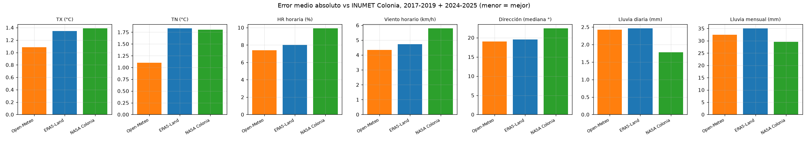
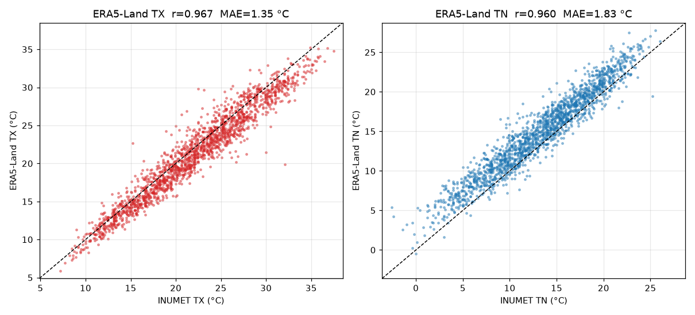
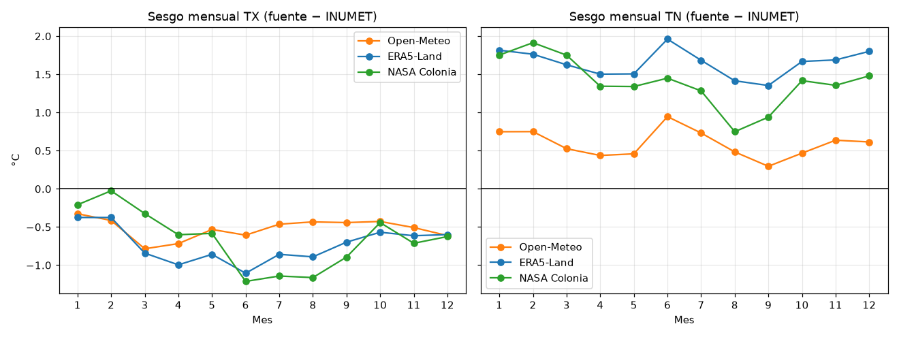
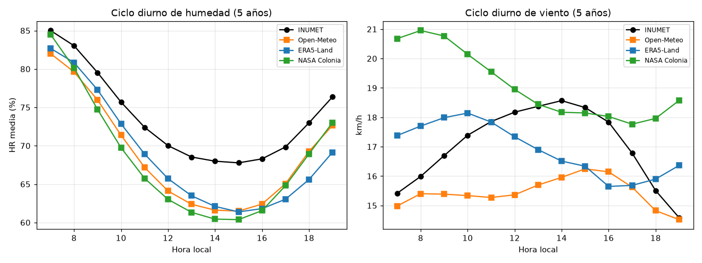
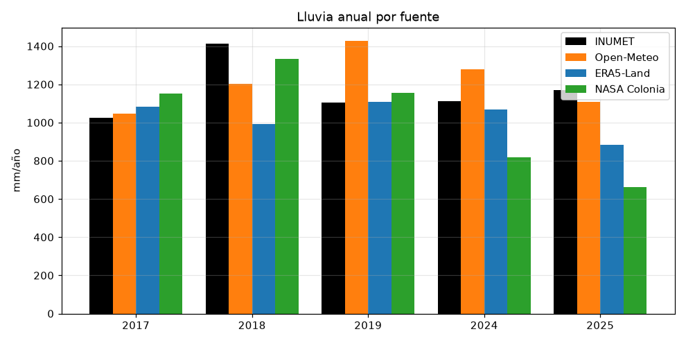
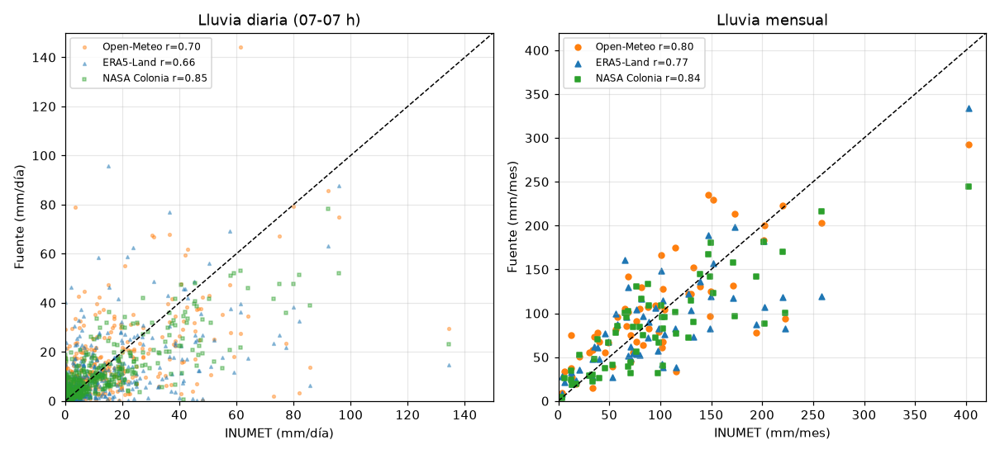

# ERA5-Land (Copernicus) vs INUMET — Estación Colonia (Laguna de los Patos)

**Pregunta:** ¿ERA5-Land se parece lo suficiente a INUMET (tomado como verdad) en la estación Colonia como para usarlo? ¿Es mejor que Open-Meteo o NASA?

## Resumen ejecutivo

**ERA5-Land no es mejor que Open-Meteo en ninguna variable.** Queda en segundo lugar en temperatura máxima, humedad, viento y dirección, y empata con NASA en temperatura mínima. En lluvia es la peor de las tres a escala diaria. Su único punto fuerte es la **distribución de velocidades de viento**: no tiene sesgo en la media y los vientos fuertes salen casi iguales a los de la estación.

Comparación sobre los mismos días y horas (2017-2019 y 2024-2025):

| Variable | Open-Meteo | ERA5-Land | NASA Colonia |
|---|---|---|---|
| TX — MAE / sesgo | **1.08** / −0.52 °C | 1.35 / −0.73 °C | 1.39 / −0.66 °C |
| TN — MAE / sesgo | **1.10** / +0.59 °C | 1.83 / **+1.65 °C** | 1.80 / +1.40 °C |
| HR horaria — MAE / r | **7.4 %** / 0.85 | 8.0 % / 0.81 | 9.9 % / 0.72 |
| Viento horario — MAE / sesgo / r | **4.3** / −1.6 / 0.74 | 4.7 / **−0.1** / 0.70 | 5.8 / +2.0 / 0.66 |
| Viento P99 (INUMET: 38.9 km/h) | 34.2 | **37.3** | 43.1 |
| Dirección — mediana del error / % ≤ 45° | **19°** / 86 % | 19.5° / 83 % | 22° / 78 % |
| Lluvia diaria — MAE / r | 2.42 mm / 0.70 | 2.46 mm / 0.66 | **1.78 mm / 0.85** |
| Lluvia ≥ 1 mm — CSI | 0.60 | 0.64 | **0.69** |
| Lluvia mensual — MAE / r | 32.5 mm / 0.80 | 35.0 mm / 0.77 | **29.6 mm / 0.84** |
| Lluvia — sesgo 5 años | **+4 %** | −12 % | −12 % |

---

## 1. Datos y método

| | INUMET Colonia | ERA5-Land |
|---|---|---|
| Ubicación | −34.4519, −57.7678 | Punto de grilla **−34.40, −57.80** (0.1° ≈ 9 km), ~6.5 km al NNO |
| Fuente | Estación convencional | Copernicus CDS, dataset `reanalysis-era5-land-timeseries` |
| Variables | TX, TN, HR, viento 10 m, lluvia | `t2m`, `d2m`, `u10`, `v10`, `tp` (horarias, en UTC) |

- **Punto de grilla:** ERA5-Land solo tiene datos sobre tierra. El punto más cercano a la estación (−34.50, −57.80) cae en el Río de la Plata y la serie viene vacía, así que se usó el punto de tierra más cercano.
- **Conversiones:**
  - La hora pasa de UTC a local (UTC−3). La correlación horaria con 0 h de desfase es la esperada (0.813).
  - La temperatura se pasa de K a °C.
  - **La humedad relativa no viene en ERA5-Land**: la calculé a partir de la temperatura y el punto de rocío con la fórmula de Magnus.
  - El viento se calcula a partir de las componentes u/v (velocidad y dirección meteorológica).
  - La lluvia `tp` viene en metros por hora y se pasa a mm.
- **Alineaciones:**
  - TX y TN son el máximo y el mínimo horario del día calendario local.
  - Humedad y viento se comparan solo de 07 a 19 h.
  - La lluvia se suma de 07 h a 07 h, con la convención de INUMET.

---

## 2. Temperatura

| Métrica | TX | TN |
|---|---|---|
| Sesgo | −0.73 °C | **+1.65 °C** |
| MAE | 1.35 °C | 1.83 °C |
| r | 0.967 | 0.960 |
| Días dentro de ±2 °C | 78 % | 60 % |

El sesgo es muy estable: para TN va de +1.4 a +1.9 °C según el año y es parecido en todos los meses. Eso lo hace **muy corregible**:

| Validación 2024-2025 (corrección calibrada en 2017-2019) | Sin corregir | Corregida |
|---|---|---|
| TX ERA5-Land | 1.30 °C | **1.07 °C** |
| TN ERA5-Land | 1.81 °C | **1.12 °C** |
| TX Open-Meteo (referencia) | 0.98 °C | 0.87 °C |
| TN Open-Meteo (referencia) | 1.02 °C | 0.97 °C |

Corregida, ERA5-Land queda cerca de Open-Meteo, pero sigue un poco peor.

**Extremos:** suaviza todavía más que Open-Meteo.

| Indicador | INUMET | Open-Meteo | ERA5-Land | NASA |
|---|---|---|---|---|
| Días TX ≥ 30 °C | 203 | 148 | 122 | 128 |
| Días TX ≥ 35 °C | 14 | 9 | 3 | 5 |
| Días TN ≤ 3 °C | 48 | 25 | 10 | 3 |
| Heladas (TN ≤ 0 °C) | 8 | 6 | 1 | 0 |

**Veredicto: usable con corrección (TX +0.7 °C, TN −1.65 °C), pero inferior a Open-Meteo.** No sirve para extremos.

---

## 3. Humedad relativa

| Métrica | ERA5-Land | Open-Meteo |
|---|---|---|
| Sesgo | −4.8 % | −4.8 % |
| MAE horaria / diaria | 8.0 % / 6.6 % | 7.4 % / 6.0 % |
| r horaria | 0.813 | 0.852 |

Por año: −2.5 % (2017), −2.9 % (2018), −1.3 % (2019), −6.8 % (2024), **−10.5 % (2025)**. Es el mismo salto de 2024-2025 que muestran las otras fuentes, porque la que sube es la estación.

**Veredicto: segunda mejor, muy cerca de Open-Meteo.** Valen las mismas cautelas: corregir ~+5 % (o ~+10 % desde 2024) y no usarla para umbrales altos.

---

## 4. Viento

| Métrica | ERA5-Land | Open-Meteo |
|---|---|---|
| Sesgo | **−0.1 km/h** | −1.6 km/h |
| MAE horaria / diaria | 4.7 / 2.8 km/h | **4.3 / 2.7 km/h** |
| r horaria / diaria | 0.70 / 0.85 | **0.74 / 0.87** |
| Mediana / P90 / P99 (INUMET: 16.7 / 27.8 / 38.9) | **16.3 / 27.6 / 37.3** | 14.8 / 24.9 / 34.2 |
| Dirección: mediana del error / % ≤ 45° | 19.5° / 83 % | **19° / 86 %** |

- ERA5-Land es la fuente con la **distribución de velocidades más realista**: la media y la frecuencia de vientos fuertes salen casi iguales a las de la estación.
- **Su ciclo diario está desfasado:** el máximo cae a media mañana (10-11 h) y no a la tarde (14 h) como en la estación. Por eso, hora a hora, acierta menos que Open-Meteo.

**Veredicto:**
- Para estadísticas de viento (distribución, frecuencia de vientos > 30 km/h, potencial eólico medio): **ERA5-Land es la mejor opción**.
- Para la serie horaria o diaria: Open-Meteo.

---

## 5. Precipitación

| Umbral | Días INUMET | Días ERA5-Land | POD | FAR | CSI |
|---|---|---|---|---|---|
| ≥ 1 mm | 389 | 493 | 0.88 | 0.30 | 0.64 |
| ≥ 5 mm | 248 | 264 | 0.77 | 0.28 | 0.60 |
| ≥ 10 mm | 175 | 161 | 0.60 | 0.35 | 0.46 |
| ≥ 20 mm | 93 | 71 | 0.44 | 0.42 | 0.33 |
| ≥ 50 mm | 19 | 9 | 0.21 | 0.56 | 0.17 (4 de 19) |

| Año | INUMET | ERA5-Land | Dif. |
|---|---|---|---|
| 2017 | 1024 mm | 1083 mm | +6 % |
| 2018 | 1412 mm | 992 mm | **−30 %** |
| 2019 | 1105 mm | 1108 mm | 0 % |
| 2024 | 1113 mm | 1067 mm | −4 % |
| 2025 | 1171 mm | 882 mm | **−25 %** |

ERA5-Land detecta razonablemente los días de lluvia (CSI 0.64, entre Open-Meteo y NASA). En cambio, **es la que peor capta los eventos fuertes**. Ejemplo: el 28/02/2025 dio 14.8 mm cuando hubo 134.5 mm. En el total subestima un 12 %, con años que fallan entre −25 % y −30 %.

**Veredicto: no apto para cantidad de lluvia.** Es más débil que Open-Meteo para totales y que NASA para la ocurrencia diaria.

---

## 6. Reproducibilidad

- `descargar_era5_land.py`: descarga desde el CDS. Requiere el archivo `~/.cdsapirc` con un token y aceptar la licencia del dataset.
- `comparacion_era5_land.py`: comparación y figuras. Reutiliza el código de los análisis de Open-Meteo y NASA.
- Datos: `datos_era5_land/`. Métricas: `metricas_era5_land.json`. Figuras: `figuras/`.
