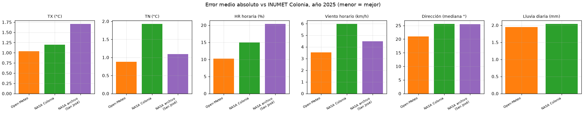
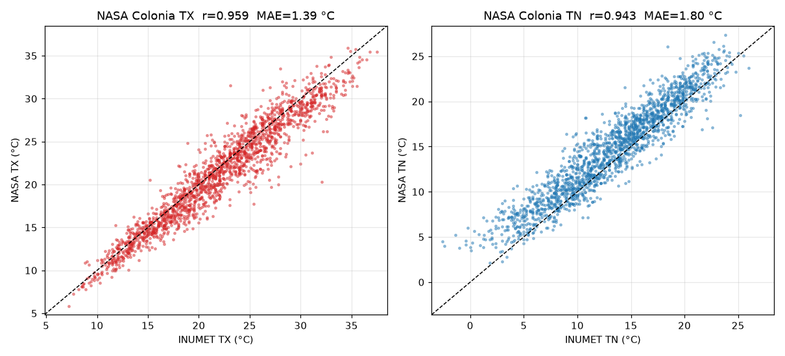
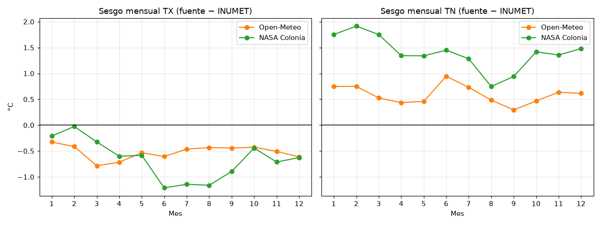
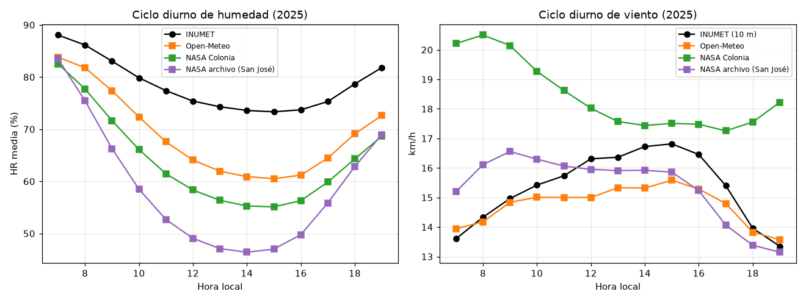
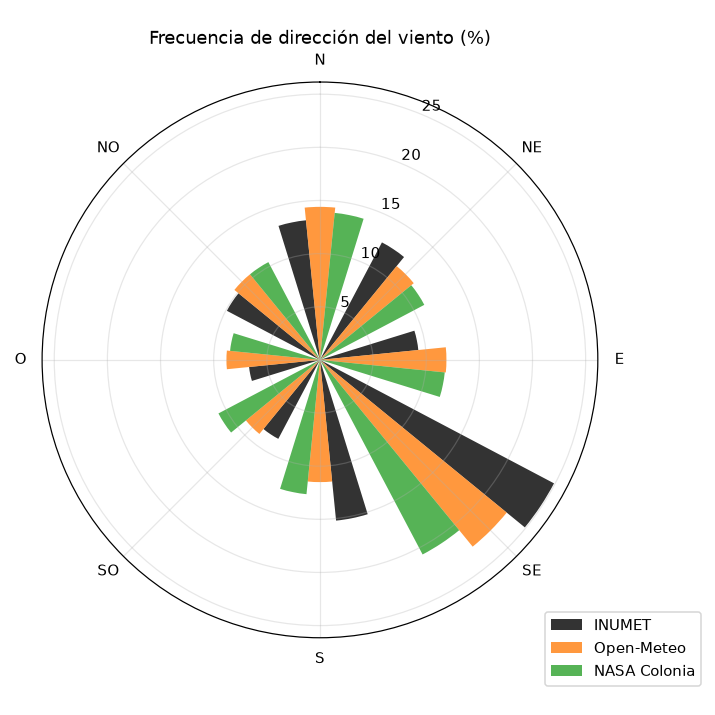
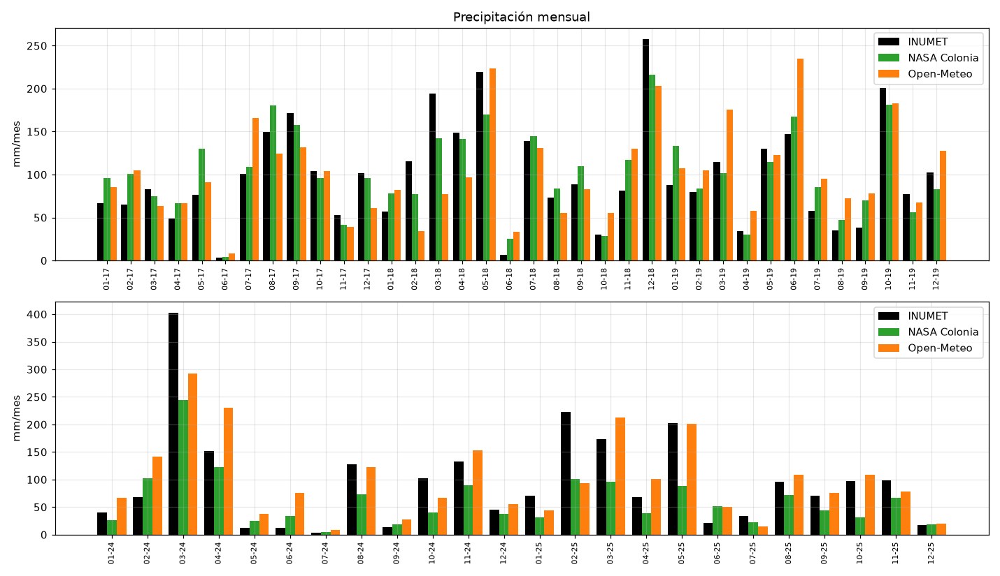
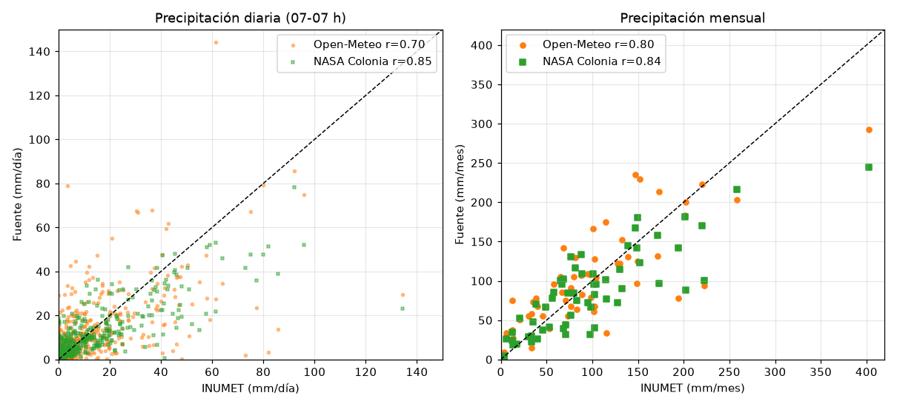

# NASA POWER vs INUMET — Estación Colonia (Laguna de los Patos)

**Pregunta:** ¿los datos de NASA POWER se parecen lo suficiente a los de INUMET (tomados como verdad) en la estación de Colonia (lat −34.4518742, lon −57.7677703) como para usarlos? ¿Y cómo se comparan con Open-Meteo?

## ⚠️ Aviso previo: el archivo entregado no es de Colonia

El archivo `Comparación datos INUMET vs NASA - NASA.csv` dice "Datos para San José". Lo verifiqué contra la API de NASA POWER: es **exactamente** la serie del punto de la estación **San José** (−34.35, −56.75), a **~94 km al este de Colonia**, solo para **2025**, con hora solar local (UTC−4).

Para que la comparación sea justa, **descargué también NASA POWER para las coordenadas exactas de Colonia** (2017-2019 y 2024-2025, mismas fechas que INUMET). Agregué la lluvia (`PRECTOTCORR`) y el viento a 10 m (`WS10M`, `WD10M`), que el archivo original no traía. Se evalúan tres fuentes:

| Nombre en este informe | Qué es | Período |
|---|---|---|
| **NASA Colonia** | NASA POWER (MERRA-2) en las coordenadas de la estación Colonia | 2017-2019, 2024-2025 |
| **NASA archivo (San José)** | El CSV entregado (punto San José) | 2025 |
| **Open-Meteo** | El CSV del análisis anterior | 2017-2019, 2024-2025 |

## Resumen ejecutivo

**Período completo (5 años), contra INUMET Colonia:**

| Variable | Open-Meteo | NASA Colonia | Mejor |
|---|---|---|---|
| TX diaria — MAE / sesgo / r | **1.08 °C** / −0.52 / 0.976 | 1.39 °C / −0.66 / 0.959 | Open-Meteo |
| TN diaria — MAE / sesgo / r | **1.10 °C** / +0.59 / 0.968 | 1.80 °C / **+1.40** / 0.943 | Open-Meteo |
| HR horaria — MAE / sesgo / r | **7.4 %** / −4.8 / 0.852 | 9.9 % / −5.3 / 0.717 | Open-Meteo |
| Viento horario — MAE / sesgo / r | **4.3 km/h** / −1.6 / 0.738 | 5.8 km/h / **+2.0** / 0.662 | Open-Meteo |
| Dirección — mediana del error / % ≤ 45° | **19°** / 86 % | 22° / 78 % | Open-Meteo |
| Lluvia diaria — MAE / r | 2.42 mm / 0.70 | **1.78 mm / 0.85** | NASA |
| Lluvia: días ≥ 1 mm detectados (POD) / CSI | 0.89 / 0.60 | **0.94 / 0.69** | NASA |
| Lluvia mensual — MAE / r | 32.5 mm / 0.80 | **29.6 mm / 0.84** | NASA (ligeramente) |
| Lluvia — sesgo total 5 años | **+4 %** | −12 % | Open-Meteo |
| Lluvia — sesgo 2024 / 2025 | **+15 % / −5 %** | **−27 % / −43 %** | Open-Meteo |

**Conclusión corta:**
- En **temperatura, humedad y viento, NASA es peor que Open-Meteo** en todas las métricas. NASA Colonia además tiene un sesgo cálido de +1.4 °C en las mínimas y casi no registra días fríos: detecta 3 días con TN ≤ 3 °C contra 48 reales, y 0 heladas de 8.
- En **lluvia, NASA acierta mejor *cuándo* llueve** (correlación diaria 0.85 vs 0.70). En cambio, **subestima mucho *cuánto* llueve en los años recientes** (−27 % en 2024 y −43 % en 2025). Por eso no es confiable para totales actuales.
- El archivo del punto San José da para Colonia resultados peores que NASA Colonia en TX, humedad y dirección. No conviene usarlo para Colonia.

---

## 1. Datos y método

| | INUMET Colonia | NASA Colonia | NASA archivo |
|---|---|---|---|
| Coordenadas | −34.4519, −57.7678 | −34.4519, −57.7678 (celda MERRA-2 de 0.5° × 0.625° ≈ 55 × 58 km) | −34.3519, −56.7496 (San José) |
| Elevación | 24.8 m | 22 m (media de la celda) | — |
| Variables | TX, TN, HR, viento 10 m, lluvia | T2M_MAX, T2M_MIN, RH2M, WS10M, WD10M, PRECTOTCORR | T2M_MAX, T2M_MIN, RH2M, WS2M, WD2M |
| Hora | Local (UTC−3) | UTC, convertida a local | LST (UTC−4), convertida a local (+1 h) |

**Alineaciones** (las mismas reglas que con Open-Meteo):
- Humedad y viento se comparan solo de 07 a 19 h, que es cuando observa la estación.
- La lluvia se suma de 07 h del día D a 07 h del día D+1 (convención de INUMET). Con NASA esto importa mucho: usando el valor diario de NASA tal cual viene (día calendario), la correlación cae de 0.85 a **0.68**.
- **Viento del archivo (a 2 m):** INUMET mide a 10 m, así que lo escalé con el cociente mediano WS10M/WS2M de NASA en Colonia (**×1.22**). Sin escalar, la media queda 2.8 km/h por debajo.
- Métricas: sesgo (fuente − INUMET), MAE, RMSE, correlación r. En lluvia también POD, FAR y CSI (definidos en el informe de Open-Meteo).

---

## 2. Temperatura

| Métrica (5 años) | TX NASA | TX Open-Meteo | TN NASA | TN Open-Meteo |
|---|---|---|---|---|
| Sesgo | −0.66 °C | −0.52 °C | **+1.40 °C** | +0.59 °C |
| MAE | 1.39 °C | 1.08 °C | 1.80 °C | 1.10 °C |
| RMSE | 1.85 °C | 1.43 °C | 2.26 °C | 1.47 °C |
| r | 0.959 | 0.976 | 0.943 | 0.968 |
| Días dentro de ±2 °C | 77 % | 90 % | **63 %** | 86 % |

**Extremos (5 años):**

| Indicador | INUMET | Open-Meteo | NASA Colonia |
|---|---|---|---|
| Días TX ≥ 30 °C | 203 | 148 | 128 |
| Días TX ≥ 35 °C | 14 | 9 | 5 |
| Días TN ≤ 3 °C | 48 | 25 | **3** |
| Heladas (TN ≤ 0 °C) | 8 | 6 | **0** |

La celda de NASA abarca una buena parte del Río de la Plata. El agua suaviza las noches, y por eso las mínimas salen ~1.4 °C más altas y casi desaparecen los días fríos.

**Corrección de sesgo mensual** (calibrada en 2017-2019 y probada en 2024-2025):

| | TX MAE sin corregir → corregida | TN MAE sin corregir → corregida |
|---|---|---|
| NASA Colonia | 1.28 → 1.23 °C | 1.91 → **1.39 °C** |
| Open-Meteo | 0.98 → **0.87 °C** | 1.02 → **0.97 °C** |

Aun corregida, NASA queda peor que Open-Meteo **sin** corregir.

**Archivo San José (2025) contra Colonia:** TX MAE 1.71 °C (sesgo +1.17 °C, porque el interior es más cálido de día) y TN MAE 1.09 °C. Contra su propia estación (San José), TX MAE 1.14 °C y TN MAE 2.05 °C.

**Veredicto temperatura NASA: usable pero inferior.** No hay ningún caso en que convenga usar NASA en lugar de Open-Meteo para temperatura en Colonia. Para heladas y frío es directamente **no apto**.

---

## 3. Humedad relativa

| Métrica | NASA Colonia (5 años) | Open-Meteo (5 años) | NASA archivo (2025) | Open-Meteo (2025) |
|---|---|---|---|---|
| Sesgo | −5.3 % | −4.8 % | **−19.8 %** | −9.5 % |
| MAE | 9.9 % | 7.4 % | 20.4 % | 10.2 % |
| r | 0.717 | 0.852 | 0.739 | 0.853 |
| Dentro de ±10 % | 59 % | 76 % | 24 % | — |

Por año, NASA Colonia tiene sesgos de −2.3 % (2017), −1.6 % (2018), 0.0 % (2019), −8.4 % (2024) y **−14.4 % (2025)**. Muestra el mismo salto que Open-Meteo en 2024-2025, porque es INUMET el que sube. Además, NASA tiene peor correlación en todos los años.

Las dos versiones de NASA exageran el secado de la tarde. El archivo de San José marca 47 % a las 14 h, cuando la estación de Colonia registra 74 %.

**Veredicto humedad NASA: no recomendable.** Open-Meteo es mejor en todos los indicadores.

---

## 4. Viento

### 4.1 Velocidad

| Métrica | NASA Colonia 10 m | Open-Meteo 10 m | NASA archivo (2 m ×1.22, 2025) |
|---|---|---|---|
| Sesgo | **+2.0 km/h (+12 %)** | −1.6 km/h | 0.0 km/h |
| MAE horario | 5.8 km/h | 4.3 km/h | 4.5 km/h |
| r horario | 0.662 | 0.738 | 0.665 |
| MAE del promedio diario | 3.9 km/h | 2.7 km/h | 2.8 km/h |
| P99 (INUMET 38.9 km/h) | 43.1 km/h | 34.2 km/h | — |

- **NASA Colonia tiene el ciclo diurno invertido:** su viento es máximo de mañana (~20 km/h) y mínimo de tarde, cuando la estación tiene su máximo. Es el comportamiento típico de una celda dominada por agua.
- El archivo de San José coincide en la media solo porque lo escalé a 10 m. Su correlación es igual de baja (0.665).

### 4.2 Dirección

| | NASA Colonia | Open-Meteo | NASA archivo (2025) |
|---|---|---|---|
| Mediana del error | 22° | **19°** | 26° |
| % de horas con error ≤ 45° | 78 % | **86 %** | 74 % |

Todas reproducen la dirección dominante del SE. NASA reparte más frecuencia hacia el SO y el O.

**Veredicto viento NASA: inferior a Open-Meteo.** Sobreestima la velocidad y su ciclo diario no se parece al de la estación.

---

## 5. Precipitación (solo NASA Colonia; el archivo no la incluye)

### 5.1 Diaria (07-07 h)

| Umbral | NASA POD / FAR / CSI | Open-Meteo POD / FAR / CSI |
|---|---|---|
| ≥ 1 mm | **0.94 / 0.28 / 0.69** | 0.89 / 0.35 / 0.60 |
| ≥ 5 mm | **0.85 / 0.26 / 0.66** | 0.81 / 0.31 / 0.59 |
| ≥ 10 mm | **0.73 / 0.24 / 0.59** | 0.71 / 0.32 / 0.53 |
| ≥ 20 mm | 0.58 / **0.17** / **0.52** | 0.58 / 0.41 / 0.41 |
| ≥ 50 mm | 0.32 / 0.00 / 0.32 (6 de 19) | 0.26 / 0.58 / 0.19 (5 de 19) |

NASA detecta mejor los días de lluvia y da menos falsas alarmas. Su correlación diaria es 0.85 y su MAE 1.78 mm. **Igual subestima los eventos fuertes:** el 28/02/2025 dio 23 mm cuando INUMET midió 134.5 mm, y en marzo de 2024 da en general ~40-50 mm donde hubo 70-96 mm.

### 5.2 El problema: el volumen cae en los años recientes

| Año | INUMET | NASA Colonia | Dif. NASA | Open-Meteo | Dif. OM | r diaria NASA / OM |
|---|---|---|---|---|---|---|
| 2017 | 1024 mm | 1153 mm | +13 % | 1048 mm | +2 % | 0.85 / 0.75 |
| 2018 | 1412 mm | 1334 mm | −6 % | 1204 mm | −15 % | 0.93 / 0.66 |
| 2019 | 1105 mm | 1155 mm | +5 % | 1426 mm | +29 % | 0.89 / 0.76 |
| 2024 | 1113 mm | **819 mm** | **−27 %** | 1278 mm | +15 % | 0.91 / 0.70 |
| 2025 | 1171 mm | **664 mm** | **−43 %** | 1110 mm | −5 % | 0.74 / 0.75 |

En 2017-2019 NASA es la mejor fuente de lluvia: queda dentro de ±13 % por año, con un MAE mensual de ~21 mm frente a ~32 mm de Open-Meteo. **En 2024-2025, en cambio, entrega entre el 50 % y el 67 % de la lluvia real**, aunque siga acertando qué días llueve. El CSI se mantiene en ~0.70. Una causa probable es que la corrección con pluviómetros que usa `PRECTOTCORR` cambió o perdió estaciones en el período reciente. No lo pude confirmar, pero el patrón es claro y afecta justo a los datos actuales.

**Veredicto lluvia NASA:**
- *Saber si llovió o no en un día:* es la mejor de las dos fuentes.
- *Cantidad de lluvia (diaria, mensual o anual) en años recientes:* **no apto** (−27 % a −43 %).
- *Series históricas (≤ 2019):* razonable, pero un error de ±13 % por año no la vuelve un reemplazo de INUMET.

---

## 6. Reproducibilidad

- Script: `comparacion_nasa.py` (reutiliza las funciones de `../analisis_open_meteo_vs_inumet/comparacion.py`). Si faltan los datos de NASA Colonia, los descarga de la API de NASA POWER.
- Datos de NASA descargados: `datos_nasa_colonia/`.
- Métricas completas: `metricas_nasa.json`.
- Figuras: `figuras/`.
