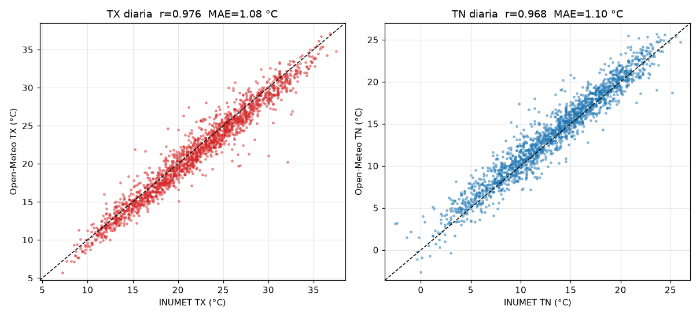
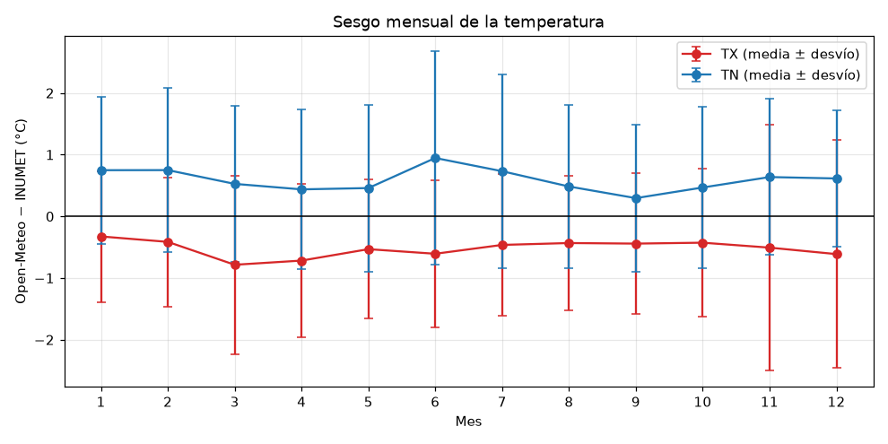
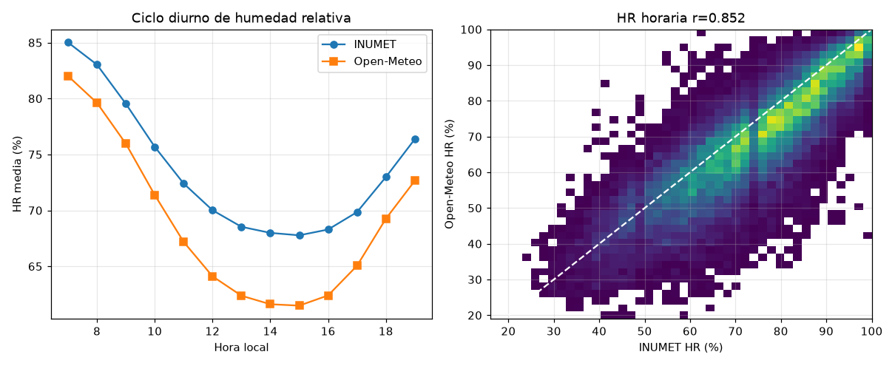
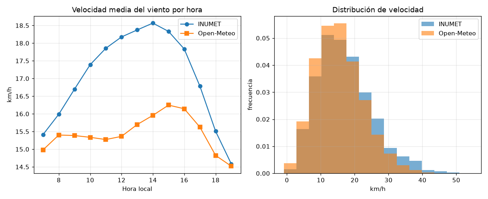
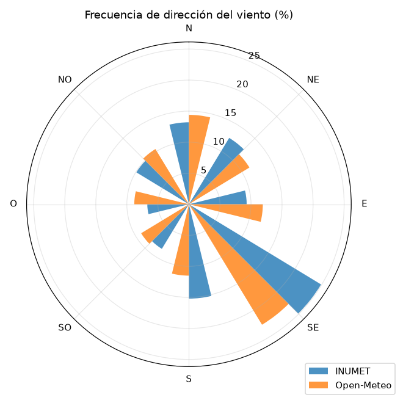
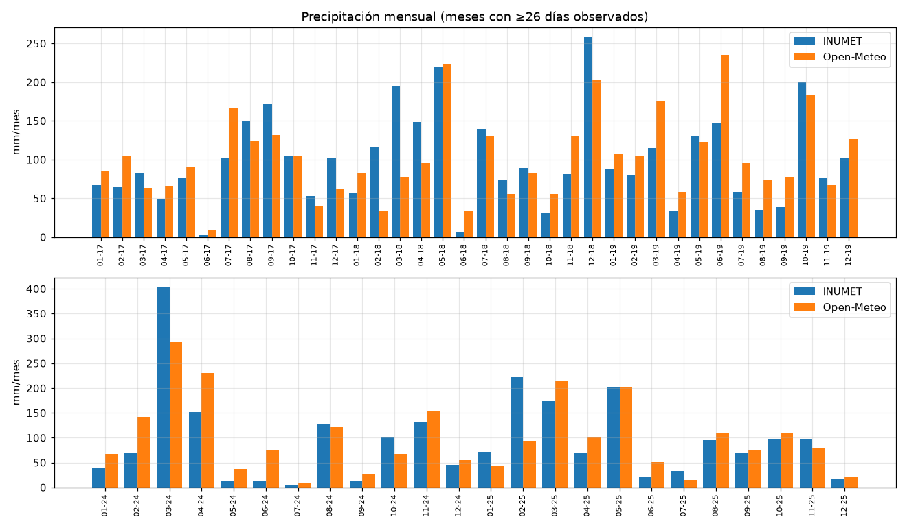
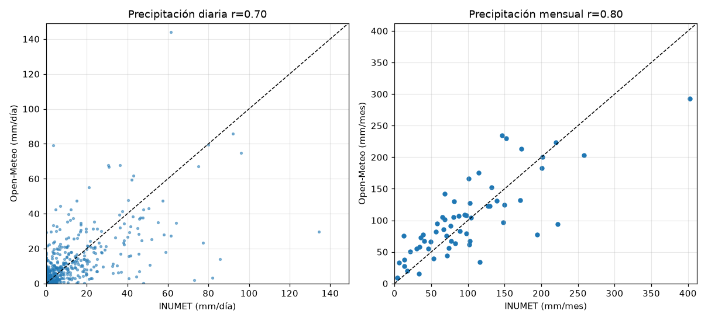

# Open-Meteo vs INUMET — Estación Colonia (Laguna de los Patos)

**Pregunta:** ¿los datos de Open-Meteo (`open-meteo-34.41S57.74W25m.csv`) se parecen lo suficiente a los de INUMET (tomados como verdad) en la estación ubicada en lat −34.4518742, lon −57.7677703 como para usarlos?

## Resumen ejecutivo

| Variable | Error típico de Open-Meteo | Sesgo (OM − INUMET) | Correlación | ¿Se puede usar? |
|---|---|---|---|---|
| **Temperatura máxima diaria (TX)** | MAE 1.08 °C | −0.52 °C (OM más fría) | 0.976 | **Sí** (con corrección de sesgo, ideal) |
| **Temperatura mínima diaria (TN)** | MAE 1.10 °C | +0.59 °C (OM más cálida) | 0.968 | **Sí** (con corrección de sesgo, ideal) |
| **Humedad relativa horaria** | MAE 7.4 % | −4.8 % (OM más seca) | 0.852 | **Con cautela** — sesgo creciente, ~−9 % en 2024-2025 |
| **Velocidad del viento horaria** | MAE 4.3 km/h | −1.6 km/h (−9 %) | 0.738 | **Con cautela** — mejor en promedios diarios; subestima rachas fuertes |
| **Dirección del viento** | Mediana del error 19° | — | — | **Sí** para rosa de vientos / dirección predominante |
| **Precipitación diaria** | MAE 2.4 mm | +0.13 mm/día | 0.70 | **No** para eventos puntuales |
| **Precipitación mensual / anual** | MAE 32 mm/mes (~33 %) | +4 % en el total | 0.80 | **Solo orientativo** (climatología de largo plazo) |

**Conclusión corta:** Open-Meteo es **confiable para temperatura** (máximas y mínimas), **aceptable para humedad y viento** si se trabaja con promedios y se corrige el sesgo, y **no reemplaza a INUMET para lluvia diaria ni para totales mensuales precisos**. Para lluvia sirve para conocer el régimen de largo plazo (total de los 5 años con +4 % de diferencia), pero cualquier mes o año individual puede errar entre −15 % y +29 %.

---

## 1. Datos y método

### 1.1 Fuentes

| | INUMET | Open-Meteo |
|---|---|---|
| Ubicación | Colonia – Aeropuerto Laguna de los Patos (−34.45187, −57.76777, 24.8 m) | Punto de grilla −34.41125, −57.73584, 25 m |
| Distancia entre ambos | **≈ 5.4 km** (el punto de Open-Meteo está al NE de la estación) | |
| Tipo de dato | Observación en estación convencional | Reanálisis/modelo (serie histórica, no es una medición) |
| Período comparado | 2017-2019 y 2024-2025 (los años que tiene INUMET) | 2017-2025 continuo |
| Archivos | `1793295547972-CLIM-2026-0000193.xlsx` (TX/TN, HR, viento) y `*/Precipitación diaria.xlsx`, hoja *Colonia* (pluviómetro 2774) | `open-meteo-34.41S57.74W25m.csv` (horario + diario) |

**Total comparado:** 1823 días de TX, 1809 de TN, 1825 de precipitación, ~23 400 horas de humedad y viento.

### 1.2 Alineación de los datos (importante)

Antes de comparar verifiqué empíricamente las convenciones de cada fuente:

- **Hora:** los datos horarios de INUMET están en **hora local (UTC−3)**, igual que Open-Meteo. El desfase de 0 h da la mejor correlación; ±1 h ya empeora.
- **Horario de observación:** Colonia registra humedad y viento **solo de 07 a 19 h** (13 observaciones por día). La noche no se puede validar para esas dos variables.
- **TX / TN:** se compararon con el máximo/mínimo horario de Open-Meteo en el **día calendario** (00–24 h), que fue la ventana con menor error.
- **Precipitación:** INUMET acumula la lluvia de **07 h del día D a 07 h del día D+1 y la rotula con la fecha D**. Con esa ventana la correlación diaria es 0.70; si se usa la suma del día calendario de Open-Meteo baja a **0.56**. **Si usás la lluvia diaria de Open-Meteo, hay que sumarla de 07 a 07 h**, no por día calendario.
- **Unidades:** el viento de INUMET viene en nudos (convertido a km/h × 1.852). "TRAZA" se tomó como 0 mm (160 días).

### 1.3 Métricas

- **Sesgo** = promedio de (Open-Meteo − INUMET). Negativo significa que Open-Meteo da valores más bajos.
- **MAE** = error absoluto medio (cuánto se equivoca en promedio, sin importar el signo).
- **RMSE** = raíz del error cuadrático medio (penaliza más los errores grandes).
- **r** = correlación de Pearson (1 = siguen exactamente el mismo patrón).
- Para la lluvia, además: **POD** (porcentaje de días de lluvia detectados), **FAR** (porcentaje de días que OM marca lluvia y no llovió), **CSI** (índice de acierto combinado, de 0 a 1).

Criterio práctico que usé para decidir "apto": temperatura con MAE ≤ 1.5 °C y |sesgo| ≤ 1 °C; humedad con MAE ≤ 10 %; viento con |sesgo| ≤ 15 % y r ≥ 0.7; lluvia mensual con r ≥ 0.9 y la mayoría de los meses dentro de ±20 %. Son umbrales orientativos habituales al validar reanálisis contra estaciones, no una norma oficial.

---

## 2. Temperatura (TX y TN)

| Métrica | TX | TN |
|---|---|---|
| Media INUMET | 21.99 °C | 13.27 °C |
| Media Open-Meteo | 21.47 °C | 13.86 °C |
| Sesgo | **−0.52 °C** | **+0.59 °C** |
| MAE | 1.08 °C | 1.10 °C |
| RMSE | 1.43 °C | 1.47 °C |
| Correlación | 0.976 | 0.968 |
| Días con error ≤ 1 °C | 58 % | 58 % |
| Días con error ≤ 2 °C | 90 % | 86 % |
| Días con error ≤ 3 °C | 97 % | 95 % |
| Error en el 5 % peor de los días | > 2.6 °C | > 3.0 °C |

**Por estación del año:**

| Estación | TX sesgo / MAE | TN sesgo / MAE |
|---|---|---|
| Verano (DEF) | −0.45 / 1.05 °C | +0.70 / 1.08 °C |
| Otoño (MAM) | −0.68 / 1.14 °C | +0.48 / 1.03 °C |
| Invierno (JJA) | −0.50 / 1.03 °C | +0.72 / 1.27 °C |
| Primavera (SON) | −0.46 / 1.12 °C | +0.47 / 1.02 °C |

**Por año:** el comportamiento es estable (TX MAE entre 0.93 y 1.32 °C; TN entre 0.88 y 1.29 °C). 2024-2025 es incluso algo mejor que 2017-2019.

### Interpretación

- Open-Meteo reproduce muy bien la variación día a día (r ≈ 0.97).
- Tiene un **sesgo sistemático y estable**: "achica" la amplitud térmica diaria en ~1.1 °C (máximas ~0.5 °C más bajas y mínimas ~0.6 °C más altas). Es típico de un modelo que representa una celda de varios km, en una zona costera junto al Río de la Plata.
- **Los extremos quedan suavizados**, lo cual importa si vas a contar días por encima o debajo de un umbral:

| Indicador | INUMET | Open-Meteo | Coinciden |
|---|---|---|---|
| Días con TX ≥ 30 °C | 203 | 148 (−27 %) | 136 |
| Días con TX ≥ 35 °C | 14 | 9 | 8 |
| Días con TN ≤ 3 °C | 48 | 25 (−48 %) | 23 |
| Días con helada (TN ≤ 0 °C) | 8 | 6 | 3 |
| TX máxima absoluta | 37.5 °C | 37.1 °C | |
| TN mínima absoluta | −2.6 °C | −2.6 °C | |

### Corrección de sesgo (validada)

Calculé el sesgo medio de cada mes con 2017-2019 y lo apliqué a 2024-2025 como prueba independiente:

| | TX sin corregir | TX corregida | TN sin corregir | TN corregida |
|---|---|---|---|---|
| Sesgo 2024-25 | −0.50 °C | **+0.04 °C** | +0.47 °C | **−0.21 °C** |
| MAE 2024-25 | 0.98 °C | **0.87 °C** | 1.02 °C | **0.97 °C** |

Corrección a aplicar (a sumar al valor de Open-Meteo), calibrada con 2017-2019:

| Mes | 1 | 2 | 3 | 4 | 5 | 6 | 7 | 8 | 9 | 10 | 11 | 12 |
|---|---|---|---|---|---|---|---|---|---|---|---|---|
| TX | +0.6 | +0.5 | +0.9 | +0.7 | +0.5 | +0.5 | +0.2 | +0.5 | +0.5 | +0.4 | +0.7 | +0.5 |
| TN | −0.7 | −0.7 | −0.6 | −0.4 | −0.7 | −1.1 | −0.8 | −0.5 | −0.5 | −0.5 | −0.8 | −0.9 |

Simplificado: **TX ≈ +0.5 °C, TN ≈ −0.6 °C**.

**Veredicto temperatura: APTO.** El error medio es de ~1 °C, el 90 % de los días queda dentro de ±2 °C y el sesgo es estable y corregible. Si el uso depende de umbrales (días de calor, heladas, horas de frío, grados-día), aplicá la corrección o, mejor, un ajuste por cuantiles, porque Open-Meteo subestima la cantidad de días extremos.

---

## 3. Humedad relativa (horaria, 07–19 h)

| Métrica | Horaria | Promedio diurno diario |
|---|---|---|
| Media INUMET | 73.6 % | 73.6 % |
| Media Open-Meteo | 68.8 % | 68.8 % |
| Sesgo | **−4.8 %** | −4.8 % |
| MAE | 7.4 % | 6.0 % |
| RMSE | 9.7 % | 7.7 % |
| Correlación | 0.852 | 0.888 |
| Dentro de ±10 % | 76 % | 82 % |

- **Open-Meteo es sistemáticamente más seco**, sobre todo en verano (sesgo −7.5 %, MAE 9.3 %) y en las horas de la tarde (−6 % entre 12 y 16 h).
- **Lo más relevante: la diferencia crece con los años.**

| Año | HR media INUMET | HR media OM | Sesgo |
|---|---|---|---|
| 2017 | 72.1 % | 69.3 % | −2.7 % |
| 2018 | 71.5 % | 69.0 % | −2.5 % |
| 2019 | 70.5 % | 69.0 % | −1.5 % |
| 2024 | 75.6 % | 67.7 % | **−7.8 %** |
| 2025 | 78.5 % | 69.1 % | **−9.5 %** |

Open-Meteo se mantiene en ~69 % todos los años, mientras que INUMET sube unos 6–8 puntos entre 2019 y 2024-2025. La temperatura no muestra ese salto, así que el cambio es propio de la humedad. Puede ser un cambio real en el entorno o el instrumental de la estación, o algo que el modelo no capta. En cualquier caso, si tomamos a INUMET como verdad, **en el período reciente Open-Meteo subestima la humedad en ~9 puntos**.

**Veredicto humedad: APTO CON CAUTELA.** Sirve para seguir la evolución diaria (r 0.85–0.89), pero hay que sumarle ~+5 % (o ~+9 % si el foco es 2024 en adelante). No lo usaría para aplicaciones sensibles a umbrales altos de humedad (por ejemplo, modelos de enfermedades de cultivos con HR > 90 %) sin corregir antes. Tampoco se pudo validar la noche, porque la estación no observa de 20 a 06 h.

---

## 4. Viento (07–19 h)

### 4.1 Velocidad

| Métrica | Horaria | Promedio diurno diario |
|---|---|---|
| Media INUMET | 17.0 km/h | 17.1 km/h |
| Media Open-Meteo | 15.4 km/h | 15.4 km/h |
| Sesgo | **−1.6 km/h (−9 %)** | −1.6 km/h |
| MAE | 4.3 km/h | 2.7 km/h |
| RMSE | 5.8 km/h | 3.4 km/h |
| Correlación | 0.738 | 0.873 |
| Dentro de ±5 km/h | 66 % | 88 % |

| Percentil | INUMET | Open-Meteo |
|---|---|---|
| Mediana | 16.7 km/h | 14.8 km/h |
| P90 | 27.8 km/h | 24.9 km/h |
| P99 | 38.9 km/h | 34.2 km/h |

- **Open-Meteo no reproduce el aumento del viento por la tarde.** En la estación el viento crece de 15 km/h a las 7 h a 18.6 km/h a las 14 h (efecto de brisa/mezcla diurna). Open-Meteo apenas sube de 15.0 a 16.2 km/h.
- **Subestima los vientos fuertes** (~12 % en el percentil 99).
- Igual que con la humedad, la estación cambia con los años: el viento medio de INUMET baja de 18.8 km/h (2017) a 15.3 km/h (2025), mientras Open-Meteo se mantiene en ~15.5. Por eso el sesgo pasa de −3.0 km/h (2017) a solo −0.6 km/h (2024-2025).

### 4.2 Dirección

(Excluye calmas < 2 nudos y "variable"; 22 616 horas.)

- Mediana del error angular: **19°**; error medio: 27°.
- El **86 %** de las horas tiene un error ≤ 45° y el **95 %** ≤ 90°.
- La rosa de vientos es muy parecida: ambas fuentes muestran el SE como dirección dominante (INUMET 25 %, OM 23 %). Open-Meteo tiene algo menos de viento del S (11.5 % vs 15.2 %) y algo más del E.

**Veredicto viento: APTO CON CAUTELA.**
- *Dirección / rosa de vientos:* apto.
- *Velocidad media diaria o mensual:* apto aplicando un factor de ~×1.10 (o ~×1.04 si se toma como referencia 2024-2025).
- *Velocidad horaria, ciclo de la tarde o vientos fuertes/rachas:* no recomendable, porque los subestima.

---

## 5. Precipitación

### 5.1 Diaria (ventana 07–07 h, ya alineada)

Correlación 0.70 (Spearman 0.75), MAE 2.4 mm/día.

| Umbral | Días INUMET | Días OM | Detectados (POD) | Falsas alarmas (FAR) | CSI | Sesgo de frecuencia |
|---|---|---|---|---|---|---|
| ≥ 0.1 mm | 499 | 844 | 96 % | 43 % | 0.55 | 1.69 |
| ≥ 1 mm | 389 | 536 | 89 % | 35 % | 0.60 | 1.38 |
| ≥ 5 mm | 248 | 292 | 81 % | 31 % | 0.59 | 1.18 |
| ≥ 10 mm | 175 | 181 | 71 % | 32 % | 0.53 | 1.03 |
| ≥ 20 mm | 93 | 92 | 58 % | 41 % | 0.41 | 0.99 |
| ≥ 50 mm | 19 | 12 | 26 % | 58 % | 0.19 | 0.63 |

- **Llueve "más seguido" en Open-Meteo:** marca un 38 % más de días con ≥ 1 mm y un 69 % más con ≥ 0.1 mm. Es el típico exceso de llovizna de los modelos.
- **Detecta bien si hubo lluvia o no** (89 % de los días ≥ 1 mm; 96 % si se acepta ±1 día de diferencia).
- **Falla en la cantidad de los eventos fuertes.** De los 19 días con ≥ 50 mm solo acierta 5. Ejemplos:

| Fecha | INUMET | Open-Meteo |
|---|---|---|
| 2025-02-28 | 134.5 mm | 29.6 mm |
| 2018-03-17 | 82.0 mm | 3.3 mm |
| 2024-03-19 | 73.0 mm | 1.8 mm |
| 2018-02-09 | 85.8 mm | 13.8 mm |
| 2018-12-13 | 92.0 mm | 85.8 mm ✓ |
| 2024-03-20 | 80.0 mm | 79.3 mm ✓ |
| 2018-05-10 | 61.5 mm | 144.1 mm (sobreestima) |

### 5.2 Semanal, mensual y anual

| Agregación | Correlación | MAE | Sesgo total |
|---|---|---|---|
| Semanal (260 semanas) | 0.81 | 11.2 mm | +3 % |
| Mensual (60 meses) | 0.80 | **32.5 mm (~33 % de la media)** | +4 % |

Solo **1 de cada 3 meses** queda dentro de ±20 % (o ±10 mm) del valor de INUMET.

| Año | INUMET | Open-Meteo | Diferencia |
|---|---|---|---|
| 2017 | 1024 mm | 1048 mm | +2 % |
| 2018 | 1412 mm | 1204 mm | −15 % |
| 2019 | 1106 mm | 1426 mm | **+29 %** |
| 2024 | 1113 mm | 1278 mm | +15 % |
| 2025 | 1171 mm | 1110 mm | −5 % |
| **Total 5 años** | **5826 mm** | **6066 mm** | **+4 %** |

Climatología mensual media: Open-Meteo **duplica la lluvia de junio** (80 vs 38 mm) y **subestima marzo** (164 vs 193 mm), que es el mes más lluvioso.

**Veredicto precipitación: NO APTO como reemplazo.**
- *Lluvia de un día puntual o eventos intensos:* no sirve.
- *Lluvia mensual (balance hídrico, riego, rendimientos):* errores típicos de ±30 % y meses con errores de más de 100 mm. Solo orientativo.
- *Régimen de lluvia de largo plazo (promedio de varios años):* razonable (+4 %).
- Para lluvia conviene usar INUMET (o un pluviómetro propio) siempre que sea posible.

---

## 6. Recomendaciones prácticas

1. **Temperatura:** usá Open-Meteo con confianza. Sumá +0.5 °C a la máxima y restá 0.6 °C a la mínima (o usá la tabla mensual de la sección 2). Si contás días extremos, preferí un ajuste por cuantiles.
2. **Humedad:** usala para tendencias y promedios. Sumá ~+5 % en general o ~+9 % para el período 2024 en adelante. Evitá umbrales finos.
3. **Viento:** usá la dirección sin problemas. Para la velocidad, trabajá con promedios diarios y multiplicá por ~1.05–1.10. No la uses para rachas ni para picos de la tarde.
4. **Lluvia:** no la uses a escala diaria ni mensual cuando necesites precisión. Si la usás, **sumá la lluvia horaria de 07 h a 07 h** para que sea comparable con INUMET, y tené en cuenta que sobreestima los días de lluvia débil y subestima los eventos intensos.
5. **Limitaciones de esta validación:**
   - Es una sola estación, a 5.4 km del punto de grilla y en zona costera, donde los modelos tienen más dificultad.
   - Humedad y viento se validaron solo de día (07–19 h).
   - Open-Meteo histórico es un producto de modelo (reanálisis). Su calidad puede cambiar en otros puntos del país.
   - Las variables de Open-Meteo sin equivalente en INUMET (nubosidad, presión, suelo, temperatura aparente, rachas) no se pudieron evaluar.

---

## 7. Reproducibilidad

- Script: `comparacion.py` (en esta misma carpeta). Requiere `pandas`, `numpy`, `openpyxl`, `scipy` y `matplotlib`.
- Todas las métricas en detalle (por estación, año, hora y umbral): `metricas.json`.
- Figuras: carpeta `figuras/`.
